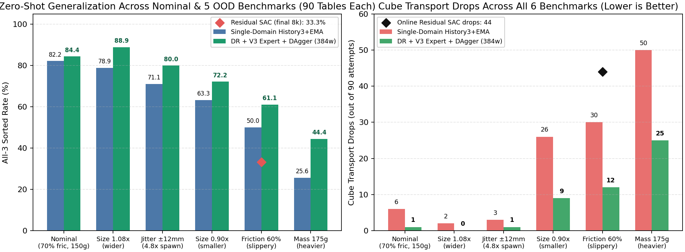

# PandaGrasp - 机械臂自主抓取、模仿学习与多物体分拣

基于 **MuJoCo + Gymnasium + PyTorch** 的 Franka Panda 机械臂仿真操作研究项目，完整覆盖从**基础方块抓取抬升**、**低摩擦/加重物理扰动抓放**、**多几何体随机朝向控制**到**三物体同桌彩色托盘分拣**、**域随机化泛化**与**在线残差 RL 对照**的全流程实验与可复现产物。

[结题总报告](docs/final_report.md) · [三帧历史与前缀 DAgger 报告](docs/place_sorting_history_report.md) · [域随机化、单因素消融与在线 RL 报告](docs/place_sorting_dr_rl_report.md) · [源码调研](docs/open_source_review.md) · [复用来源哈希](docs/local-source-sha256.json)

## 核心成果一览

| 任务阶段 | 关键指标 | 说明 |
|---|---|---|
| **基础抓取抬升 (`PandaGrasp-v0`)** | 纯 BC & BC 正则 SAC **300/300 (100%)** | 纯 SAC 24k 步 0/300；接触触发专家消除模糊等待监督 |
| **随机目标低摩擦抓放 (`PandaPickPlace-v0`)** | 稳定放置 **295/300**，运输掉落 **0/300** | 70% 摩擦 + 150 g，补示范 + 运输动作约束 |
| **三物体同桌分拣（原配对 30 布局 × 3 seed）** | 整桌全对 **42.2% → 84.4% (76/90)** | 单件 **94.8% (256/270)**，长方块与圆柱均 **90/90 (100%)**，方块掉落由 20/86 降至 **1/87** |
| **全新留出布局泛化（`1568000–1568029` × 3 seed）** | 全新名义 **74.4%**；未见 4 轴组合 **64.4%** | 冻结权重零重训，较单域三帧历史分别提升 **+10.0 pp** 与 **+21.1 pp** |
| **120 桌同预算单因素消融（`1568000–1568029`）** | `dr_only` **54.1%** vs `nominal_only` 50.0% | 同 V3 专家、同 120 桌与 384w 架构下验证域随机化净增益（全新名义 +5.5 pp，未见组合 +7.8 pp） |
| **单元测试与可复现归档** | **33/33 单元测试通过** | 所有训练权重 `.pt`、逐回合 CSV/JSON、对比图与物理校验 MP4 均随仓保留（大型 `.npz`/`.zip`/高频 trace 已由 `.gitignore` 过滤） |



## 运行

在本目录执行以下 PowerShell 命令。训练使用 CPU 和单线程 PyTorch。首次安装使用项目内虚拟环境。已有实验使用系统的 CPU 版 PyTorch 以及项目内的 `.deps`。本工作区可直接设置 `$env:PYTHONPATH = (Join-Path $PWD ".deps")`，用 `python` 执行同样的命令。

```powershell
python -m venv .venv
.\.venv\Scripts\python.exe -m pip install -r requirements.txt
$env:OPENBLAS_NUM_THREADS = '1'
$env:OMP_NUM_THREADS = '1'

.\.venv\Scripts\python.exe -m unittest discover -s tests -v
.\.venv\Scripts\python.exe -m panda_grasp.cli run --seed 0
.\.venv\Scripts\python.exe -m panda_grasp.cli run --seed 1 --methods bc sac bc_sac
.\.venv\Scripts\python.exe -m panda_grasp.cli run --seed 2 --methods bc sac bc_sac
.\.venv\Scripts\python.exe -m panda_grasp.cli videos --seed 0
```

默认每个 SAC 预算 24,000 环境步，每个 BC seed 采集 128 次演示、运行 8,000 次优化器更新。训练用 12 个独立验证场景记录曲线，最终 checkpoint 在另外 100 个场景中评估。每次复现实验可传入新 `--out`，默认 `results/pilot`。

```powershell
.\.venv\Scripts\python.exe -m panda_grasp.cli run --out results/contact_trigger --seed 0 --methods bc bc_sac --contact-trigger-expert
.\.venv\Scripts\python.exe -m panda_grasp.cli videos --out results/contact_trigger --seed 0 --methods bc bc_sac
```

要复现接触触发专家的三个 seed，对 seed 1、2 使用相同命令。此实验保持同一评估集和 BC／SAC 预算。渲染需要本机可用的 OpenGL 上下文。用 `python -m panda_grasp.analysis` 重新汇总 CSV 和绘制曲线。

## 环境接口

```python
import gymnasium as gym
import panda_grasp

with gym.make("PandaGrasp-v0") as env:
    obs, info = env.reset(seed=1)
    obs, reward, terminated, truncated, info = env.step(env.action_space.sample())
```

- 动作 `[dx, dy, dz, gripper]` 各分量在 `[-1, 1]`。前三维是世界坐标的 TCP 增量，每轴满幅 15 mm。夹爪 `-1` 闭合，`+1` 张开，中间值线性映射为开度。
- 状态向量含 37 项，详见 `panda_grasp/env.py` 的 `OBS_FIELDS`。速度为 MuJoCo 状态或 Jacobian 推导值。另提供双指载荷指示和归一化稳定计时。
- 20 Hz 策略更新，2 ms MuJoCo 子步长，120 步回合时限。位置与固定朝向由六维 IK 和关节伺服跟踪。方块仅在 reset 设初始状态，运行时由碰撞及摩擦移动。
- 初始 XY 在工作区内均匀采样，方块 yaw 与抓手朝向固定。抓取后放置需要单独实现与评估。

## 运行已训练的策略

```python
from pathlib import Path

from panda_grasp.cli import load_policy
from panda_grasp.env import PandaGraspEnv

with PandaGraspEnv() as env:
    obs, info = env.reset(seed=900000)
    make_policy = load_policy("bc", Path("results/contact_trigger/seed_0/bc"))
    predict = make_policy(env, 900000)
    while True:
        obs, reward, terminated, truncated, info = env.step(predict(obs))
        if terminated or truncated:
            print(info["is_success"], info["max_lift_m"], info["max_hold_s"])
            break
```

## 实验文件

每个 seed 下的 `scenarios.csv` 记录验证与测试场景。策略目录保存末次权重、训练曲线、100 条测试记录、汇总及成功或失败 MP4。若某种结果在某策略 seed 的 100 个场景中未发生，视频目录只有实际观测到的结果。

专家 `expert.npz` 包含观测、执行动作、专家标签动作、后继观测、奖励、terminated/truncated、演示阶段、各回合偏移、场景 seed 与成功标记。扰动演示的执行动作与 BC 监督标签分别保存。阶段字段用于分层抽样和分析。策略输入为环境状态向量。

## 第二阶段抓放与失败诊断

完整抓放环境注册为 `PandaPickPlace-v0`，每个回合都采样目标。复用提升策略的权重进行随机目标抓放 BC 训练。实验协议、测量口径和训练结果见 [抓放与失败诊断报告](docs/pick_place_report.md)。

```powershell
$env:PYTHONPATH = (Join-Path $PWD ".deps")
$env:OPENBLAS_NUM_THREADS = '1'
$env:OMP_NUM_THREADS = '1'

python -m panda_grasp.place_cli expert
0..2 | ForEach-Object { python -m panda_grasp.place_cli train --seed $_ }
python -m panda_grasp.place_cli videos --seed 0

0..2 | ForEach-Object { python -m panda_grasp.lift_diagnostics --seed $_ }
python -m panda_grasp.lift_diagnostics --seed 1 --close-probe
python -m panda_grasp.place_analysis
```

抓放训练默认读取 `results/contact_trigger/seed_*/bc/model.pt`，权重、演示、逐场景记录和视频写入 `results/pick_place`。提升诊断使用前一阶段的 SAC 和 BC+SAC 权重，输出至 `results/lift_diagnostics`。

## BC+SAC 微调退化消融

使用三个训练 seed 比较 critic 预热、降低在线探索强度和加入 BC 正则。在线预算及总交互预算分别对齐，评估使用原提升场景。[实验报告](docs/sac_ablation_report.md)

```powershell
$env:PYTHONPATH = (Join-Path $PWD ".deps")
$env:OPENBLAS_NUM_THREADS = '1'
$env:OMP_NUM_THREADS = '1'

foreach ($trainingSeed in 0..2) {
    foreach ($method in 'reference','critic_warmup','low_exploration','bc_regularized','bc_sac_total') {
        python -m panda_grasp.ablation_cli $method --seed $trainingSeed
    }
}
python -m panda_grasp.ablation_analysis
```

## 物理条件泛化和适应

冻结纯 BC 与带 BC 正则的 SAC，分别改变指间滑动摩擦和方块质量。使用筛查集选择两条策略都退化、专家仍可稳定完成的条件。新增适应交互和原训练交互分开记录。[实验报告](docs/physics_shift_report.md)

```powershell
$env:PYTHONPATH = (Join-Path $PWD ".deps")
$env:OPENBLAS_NUM_THREADS = '1'
$env:OMP_NUM_THREADS = '1'

python -m panda_grasp.physics_shift screen
0..2 | ForEach-Object { python -m panda_grasp.physics_shift screen --seed $_ }
python -m panda_grasp.physics_shift select
python -m panda_grasp.physics_shift test --conditions nominal friction_50 friction_35 mass_250 mass_300
foreach ($trainingSeed in 0..2) {
    python -m panda_grasp.physics_shift test --seed $trainingSeed --conditions nominal friction_50 friction_35 mass_250 mass_300
    python -m panda_grasp.physics_adapt --seed $trainingSeed
    python -m panda_grasp.physics_adapt --seed $trainingSeed --prefix-early-stop
}
python -m panda_grasp.physics_adapt
python -m panda_grasp.physics_analysis
```

省略 `physics_shift` 的 `--seed` 时运行专家对照。结果位于 `results/physics_shift`。

## 完整抓放的物理条件鲁棒性

冻结三组完整抓放 BC，比较名义条件、摩擦减半和方块加重至 187.5 g。对筛查选中的条件，用各 12 条新示范做 BC 适应。[完整报告](docs/place_robustness_report.md)

```powershell
$env:PYTHONPATH = (Join-Path $PWD ".deps")
$env:OPENBLAS_NUM_THREADS = '1'
$env:OMP_NUM_THREADS = '1'

python -m panda_grasp.place_robustness screen
0..2 | ForEach-Object { python -m panda_grasp.place_robustness screen --seed $_ }
python -m panda_grasp.place_adapt select
python -m panda_grasp.place_robustness test
foreach ($trainingSeed in 0..2) {
    python -m panda_grasp.place_robustness test --seed $trainingSeed
    python -m panda_grasp.place_adapt train --seed $trainingSeed --condition friction_50
    python -m panda_grasp.place_adapt train --seed $trainingSeed --condition mass_250
    python -m panda_grasp.place_robustness test --seed $trainingSeed --conditions friction_50 --probe-grip
}
python -m panda_grasp.place_robustness_analysis --videos
```

省略 `place_robustness` 的 `--seed` 时运行专家对照。结果写入 `results/place_robustness`。

## 跨物理条件的单一抓放策略

复用名义、低摩擦和加重条件的已有示范，训练不接收条件标识的混合 BC。[协议和结果](docs/place_mixed_report.md)

```powershell
$env:PYTHONPATH = (Join-Path $PWD ".deps")
$env:OPENBLAS_NUM_THREADS = '1'
$env:OMP_NUM_THREADS = '1'

0..2 | ForEach-Object { python -m panda_grasp.place_mixed_benchmark cross --seed $_ }
0..2 | ForEach-Object { python -m panda_grasp.place_mixed_train --seed $_ }
python -m panda_grasp.place_mixed_benchmark expert
foreach ($trainingSeed in 0..2) {
    python -m panda_grasp.place_mixed_benchmark combined --seed $trainingSeed
    python -m panda_grasp.place_mixed_benchmark combined --seed $trainingSeed --source nominal
}
python -m panda_grasp.place_mixed_analysis --videos
```

交叉评估引用上一轮同场景的既有单元格，新结果保存在 `results/place_mixed`。

## 温和组合的触桌诊断与适应

复查上一轮温和组合的触桌失败。采集少量新演示，平衡训练名义、两个单项改变和温和组合四种条件。[报告](docs/place_touchdown_report.md)

```powershell
$env:PYTHONPATH = (Join-Path $PWD ".deps")
$env:OPENBLAS_NUM_THREADS = '1'
$env:OMP_NUM_THREADS = '1'

0..2 | ForEach-Object { python -m panda_grasp.place_touchdown probe --seed $_ }
python -m panda_grasp.place_touchdown teacher
python -m panda_grasp.place_touchdown expert-test
foreach ($trainingSeed in 0..2) {
    python -m panda_grasp.place_touchdown frozen --seed $trainingSeed
    python -m panda_grasp.place_touchdown_train --seed $trainingSeed
}
python -m panda_grasp.place_touchdown_analysis --videos
```

## 结题复测与原始数据

[结题报告](docs/final_report.md)汇总基础抓取、SAC 消融、抓放及独立物理条件复测。稳定放置和严格夹持触桌各有统计。后者在稳定放置之上要求方块着桌时双指仍有效夹持。

以下命令直接使用 `results/place_touchdown/training/seed_*/model.pt` 及随项目保存的 `results/place_touchdown/artifact_verification.json`。复测使用 CPU，无需再训练。模型 SHA-256、专家初筛场景、独立测试场景及逐回合结果均随输出保存。

```powershell
$env:PYTHONPATH = (Join-Path $PWD ".deps")
$env:OPENBLAS_NUM_THREADS = '1'
$env:OMP_NUM_THREADS = '1'

foreach ($profile in 'frozen', 'adapted') {
    0..2 | ForEach-Object { python -m panda_grasp.place_touchdown_rescore --profile $profile --seed $_ }
}
python -m panda_grasp.place_touchdown_rescore

$out = 'results/place_boundary_reproduction'
foreach ($axis in 'reference', 'friction', 'mass') {
    python -m panda_grasp.place_boundary screen --axis $axis --out $out
}
python -m panda_grasp.place_boundary select --out $out
python -m panda_grasp.place_boundary test --out $out
0..2 | ForEach-Object { python -m panda_grasp.place_boundary test --seed $_ --out $out }
python -m panda_grasp.place_boundary_analysis --out $out --videos
```

复测存档见[初筛](results/place_boundary/screen.csv)、[场景与选点](results/place_boundary/selection.json)、[逐策略统计](results/place_boundary/summary.csv)和[测试日志](results/place_boundary/verification.txt)。

## 低摩擦运输诊断与同预算微调

[诊断和对照报告](docs/place_low_friction_report.md)记录 70% 摩擦、150 g 方块下的 seed 1 运输掉落、动作干预和 3 seed 同预算对照。复测与训练使用原冻结检查点及原抓放演示。新增结果默认写入 `results/place_low_friction`，可统一设置 `--out` 为新的目录。

```powershell
$env:PYTHONPATH = (Join-Path $PWD ".deps")
$env:OPENBLAS_NUM_THREADS = '1'
$env:OMP_NUM_THREADS = '1'

$out = 'results/place_low_friction_reproduction'
python -m panda_grasp.place_transport_diagnosis --out $out
foreach ($seed in 0..2) {
    python -m panda_grasp.place_low_friction train --seed $seed --out $out
    foreach ($method in 'frozen_bc', 'extra_demo_bc', 'bc_regularized_sac') {
        python -m panda_grasp.place_low_friction test --seed $seed --method $method --out $out
    }
}
python -m panda_grasp.place_low_friction_analysis --out $out --actor-precision
python -m panda_grasp.place_low_friction_analysis --out $out --videos
```

## 目标区边缘放置诊断与补示范

[边缘放置报告](docs/place_edge_report.md)记录 seed 2 的首次落桌与越界时序、普通专家和学习策略前缀补示范的三 seed 对照。使用上一轮的已核验补示范 BC 权重。所有方法在新场景上直接执行策略输出。

```powershell
$env:PYTHONPATH = (Join-Path $PWD ".deps")
$env:OPENBLAS_NUM_THREADS = '1'
$env:OMP_NUM_THREADS = '1'

$out = 'results/place_edge_reproduction'
python -m panda_grasp.place_edge_diagnosis --out $out
foreach ($seed in 0..2) {
    foreach ($method in 'generic_landing', 'edge_landing') {
        python -m panda_grasp.place_edge train --seed $seed --method $method --out $out
        python -m panda_grasp.place_edge test --seed $seed --method $method --out $out
        python -m panda_grasp.place_edge fixed --seed $seed --method $method --out $out
    }
    python -m panda_grasp.place_edge test --seed $seed --method frozen_previous --out $out
}
python -m panda_grasp.place_edge_analysis --out $out --videos
python -m panda_grasp.place_edge_analysis --out $out --fixed
```

## 普通专家补示范与运输动作约束

[运输动作约束报告](docs/place_transport_anchor_report.md)记录固定 250 次更新后的 seed 1 掉落原因、同预算控制及三 seed 复测。两种更新都使用上一轮同一批普通专家数据，按第 250 次更新评估。

```powershell
$env:PYTHONPATH = (Join-Path $PWD ".deps")
$env:OPENBLAS_NUM_THREADS = '1'
$env:OMP_NUM_THREADS = '1'

$out = 'results/place_transport_anchor_reproduction'
python -m panda_grasp.place_anchor_diagnosis --out $out
foreach ($seed in 0..2) {
    python -m panda_grasp.place_transport_anchor train --seed $seed --out $out
    foreach ($method in 'frozen', 'ordinary', 'transport_anchored') {
        python -m panda_grasp.place_transport_anchor test --seed $seed --method $method --out $out
    }
}
python -m panda_grasp.place_transport_anchor verify-ordinary --out $out
python -m panda_grasp.place_transport_anchor_analysis --out $out --videos
```

## 多物体随机初始朝向

[多物体实验](docs/place_objects_report.md)记录三个几何体的朝向初筛、腕部偏航专家和混合 BC。环境名为 `PandaObjectPlace-v0`，可用 `shape="cube"`、`"brick"`、`"cylinder"` 选择几何。朝向随机化保持目标和起点 XY 的配对。

```powershell
$env:PYTHONPATH = (Join-Path $PWD ".deps")
$env:OPENBLAS_NUM_THREADS = '1'
$env:OMP_NUM_THREADS = '1'

$out = 'results/place_objects_reproduction'
foreach ($shape in 'cube', 'brick', 'cylinder') {
    python -m panda_grasp.place_objects_benchmark screen --shape $shape --out $out
}
python -m panda_grasp.place_objects_benchmark screen-brick --out $out
python -m panda_grasp.place_objects_benchmark probe-grip --out $out
python -m panda_grasp.place_objects_benchmark select --out $out
foreach ($seed in 0..2) {
    python -m panda_grasp.place_objects_train train --seed $seed --out $out
    foreach ($method in 'frozen', 'mixed', 'mixed_no_yaw') {
        python -m panda_grasp.place_objects_train test --seed $seed --method $method --out $out
    }
}
python -m panda_grasp.place_objects_train test --method expert --out $out
python -m panda_grasp.place_objects_analysis --out $out --videos
```

## 三物体彩色托盘分拣

[分拣试验报告](docs/place_sorting_report.md)记录三件物体同场、逐件放入红蓝绿实体托盘的独立测试。目标位置由颜色分配给出，混合 BC 直接执行原抓放动作。使用多物体实验的三个已核验检查点。

```powershell
$env:PYTHONPATH = (Join-Path $PWD ".deps")
$env:OPENBLAS_NUM_THREADS = '1'
$env:OMP_NUM_THREADS = '1'

$out = 'results/place_sorting_reproduction'
python -m panda_grasp.place_sorting pilot --method expert --out $out
python -m panda_grasp.place_sorting test --method expert --out $out
0..2 | ForEach-Object { python -m panda_grasp.place_sorting test --method mixed --seed $_ --out $out }
python -m panda_grasp.place_sorting_analysis --out $out --videos
```

## 彩色托盘分拣的专家补示范

[补示范实验报告](docs/place_sorting_bc_report.md)记录在三物体同桌场景中采集的专家轨迹、固定验证集选模和三个 seed 的独立对照。使用前一阶段的已核验混合 BC 权重及其单物体演示。

```powershell
$env:PYTHONPATH = (Join-Path $PWD ".deps")
$env:OPENBLAS_NUM_THREADS = '1'
$env:OMP_NUM_THREADS = '1'

$out = 'results/place_sorting_bc_reproduction'
foreach ($seed in 0..2) {
    python -m panda_grasp.place_sorting_bc train --seed $seed --out $out
    foreach ($method in 'frozen', 'adapted') {
        python -m panda_grasp.place_sorting_bc test --seed $seed --method $method --out $out
    }
}
python -m panda_grasp.place_sorting_bc test --method expert --out $out
python -m panda_grasp.place_sorting_bc_analysis --out $out --videos
```

## 左右指连续接触力与滑移

[力和滑移消融报告](docs/place_sorting_contact_report.md)记录同一批原有专家示范、三个训练 seed 和匹配更新次数下的对照。历史示范通过重放补录仿真传感信息，运行每条训练指令时核对二值策略权重、专家动作与原观测。

```powershell
$env:PYTHONPATH = (Join-Path $PWD ".deps")
$env:OPENBLAS_NUM_THREADS = '1'
$env:OMP_NUM_THREADS = '1'

$out = 'results/place_sorting_contact_reproduction'
foreach ($seed in 0..2) {
    python -m panda_grasp.place_sorting_contact train --seed $seed --out $out
    foreach ($method in 'binary', 'continuous') {
        python -m panda_grasp.place_sorting_contact test --seed $seed --method $method --out $out
    }
}
python -m panda_grasp.place_sorting_contact_analysis --out $out --videos
```

## 连续力与滑移的分项及运输阶段消融

[分项消融报告](docs/place_sorting_contact_ablation_report.md)记录接触开关、仅连续力、仅滑移、仅运输时使用力与滑移、全程使用力与滑移五组 BC 的三 seed 配对评估。复现使用上一轮已核验的示范和控制组检查点。

```powershell
$env:PYTHONPATH = (Join-Path $PWD ".deps")
$env:OPENBLAS_NUM_THREADS = '1'
$env:OMP_NUM_THREADS = '1'

$out = 'results/place_sorting_contact_ablation_reproduction'
foreach ($seed in 0..2) {
    python -m panda_grasp.place_sorting_contact_ablation train --seed $seed --out $out
    foreach ($method in 'binary', 'force', 'slip', 'transport', 'continuous') {
        python -m panda_grasp.place_sorting_contact_ablation test --seed $seed --method $method --out $out
    }
}
python -m panda_grasp.place_sorting_contact_ablation_analysis --out $out --videos
```

## 连续力用于运输，滑移用于其余阶段

[分阶段触觉报告](docs/place_sorting_contact_phase_report.md)记录仅滑移组的方块运输掉落配对诊断，以及分阶段触觉与三组 BC 对照在相同新场景上的评估。复现复用已核验的专家示范和归档对照检查点。

```powershell
$env:PYTHONPATH = (Join-Path $PWD ".deps")
$env:OPENBLAS_NUM_THREADS = '1'
$env:OMP_NUM_THREADS = '1'

$out = 'results/place_sorting_contact_phase_reproduction'
foreach ($seed in 1..2) {
    python -m panda_grasp.place_sorting_slip_diagnosis --seed $seed --out $out
    python -m panda_grasp.place_sorting_slip_diagnosis --seed $seed --out $out --prelift
}
foreach ($seed in 0..2) {
    python -m panda_grasp.place_sorting_contact_phase train --seed $seed --out $out
    foreach ($method in 'binary', 'force', 'slip', 'force_in_transport') {
        python -m panda_grasp.place_sorting_contact_phase test --seed $seed --method $method --out $out
    }
}
python -m panda_grasp.place_sorting_contact_phase_analysis --out $out --videos
python -m panda_grasp.place_sorting_contact_phase_analysis --out $out --diagnosis-summary
python -m panda_grasp.place_sorting_contact_phase_analysis --out $out --diagnosis-video
```

## 抬升前用接触开关，运输用力，放置用滑移

[三阶段触觉报告](docs/place_sorting_contact_schedule_report.md)记录上一轮的配对掉落与放置诊断，以及五组 BC 的独立测试。复现使用同一批原始专家示范和已归档的对照检查点。

```powershell
$env:PYTHONPATH = (Join-Path $PWD ".deps")
$env:OPENBLAS_NUM_THREADS = '1'
$env:OMP_NUM_THREADS = '1'

$out = 'results/place_sorting_contact_schedule_reproduction'
foreach ($seed in 1..2) {
    python -m panda_grasp.place_sorting_schedule_diagnosis --seed $seed --out $out
}
python -m panda_grasp.place_sorting_schedule_diagnosis --seed 1 --out $out --height-probe
python -m panda_grasp.place_sorting_schedule_diagnosis --seed 2 --out $out --arrival-probes
python -m panda_grasp.place_sorting_schedule_diagnosis --out $out --summarize
python -m panda_grasp.place_sorting_schedule_diagnosis --out $out --videos
foreach ($seed in 0..2) {
    python -m panda_grasp.place_sorting_contact_schedule train --seed $seed --out $out
    foreach ($method in 'binary', 'force', 'slip', 'force_in_transport', 'binary_then_force_then_slip') {
        python -m panda_grasp.place_sorting_contact_schedule test --seed $seed --method $method --out $out
    }
}
python -m panda_grasp.place_sorting_contact_schedule_analysis --out $out --videos
```

## 对齐专家、前缀 DAgger 与三帧历史分拣策略

[三帧历史分拣报告](docs/place_sorting_history_report.md)记录升级同桌专家、64 维未折叠偏航与障碍上下文、一致性前缀接管 DAgger 及 3 帧短历史 + EMA 策略在相同 30 个测试布局（`1567000–1567029`）上的三 seed 对照（三件全对从 42.2% 提升至 82.2%）。

```powershell
$env:PYTHONPATH = (Join-Path $PWD ".deps")
$env:OPENBLAS_NUM_THREADS = '1'
$env:OMP_NUM_THREADS = '1'

python -m panda_grasp.place_sorting_aligned test --method expert
foreach ($seed in 0..2) {
    python -m panda_grasp.place_sorting_aligned train --seed $seed
    python -m panda_grasp.place_sorting_aligned test --method round1 --seed $seed
    python -m panda_grasp.place_sorting_dagger train --seed $seed
    python -m panda_grasp.place_sorting_dagger test --seed $seed
    python -m panda_grasp.place_sorting_history train --seed $seed
    python -m panda_grasp.place_sorting_history test --seed $seed
}
python -m panda_grasp.place_sorting_history_analysis --retry --videos
```

## 域随机化泛化、零样本 OOD 压力测试与在线残差 SAC

[域随机化与在线 RL 报告](docs/place_sorting_dr_rl_report.md)记录零样本 5 组 OOD 压力测试、V3 避障/防下溜专家（名义 29/30）、域随机化 + 前缀 DAgger + 384 宽残差三帧历史策略（名义 84.4%、6 组平均 +10.0 pp、方块掉落降 59%），以及 60% 摩擦下零新示范在线残差 SAC 的对照。

```powershell
$env:PYTHONPATH = (Join-Path $PWD ".deps")
$env:OPENBLAS_NUM_THREADS = '1'
$env:OMP_NUM_THREADS = '1'

foreach ($cond in 'friction_60', 'mass_175', 'jitter_12mm', 'size_90', 'size_108') {
    python -m panda_grasp.place_sorting_ood --condition $cond
}
foreach ($seed in 0..2) {
    python -m panda_grasp.place_sorting_dr train --seed $seed
}
foreach ($cond in 'nominal', 'friction_60', 'mass_175', 'jitter_12mm', 'size_90', 'size_108') {
    python -m panda_grasp.place_sorting_dr test --condition $cond
}
foreach ($seed in 0..2) {
    python -m panda_grasp.place_sorting_residual_sac train --seed $seed --condition friction_60 --out results/place_sorting_residual_sac_gated
    python -m panda_grasp.place_sorting_residual_sac test --seed $seed --condition friction_60 --checkpoint selected --out results/place_sorting_residual_sac_gated
    python -m panda_grasp.place_sorting_residual_sac test --seed $seed --condition friction_60 --checkpoint final --out results/place_sorting_residual_sac_gated
}
python -m panda_grasp.place_sorting_dr_analysis --rl results/place_sorting_residual_sac_gated --videos

# 全新未见布局 (1568000-1568029) 与未见组合冻结复测 + 同预算 DR vs 保真 DAgger 单因素消融
foreach ($cond in 'unseen_nominal', 'unseen_feasible_combo', 'unseen_extrap_fric57', 'unseen_combo_4way', 'unseen_combo_heavy_small') {
    foreach ($fam in 'v3_expert', 'history3_ema', 'dr_history_dagger') {
        python -m panda_grasp.place_sorting_unseen_eval --family $fam --condition $cond
    }
}
foreach ($arm in 'nominal_only', 'dr_only', 'dr_plus_dagger') {
    foreach ($seed in 0..2) {
        python -m panda_grasp.place_sorting_ablation_dr_dagger train --arm $arm --seed $seed
    }
    foreach ($cond in 'unseen_nominal', 'unseen_feasible_combo', 'unseen_extrap_fric57') {
        python -m panda_grasp.place_sorting_ablation_dr_dagger test --arm $arm --condition $cond
    }
}
```
