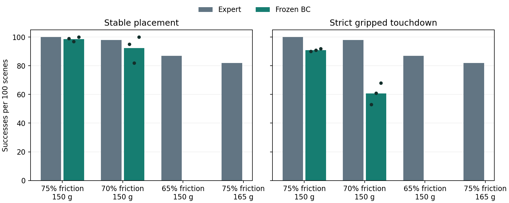

# PandaGrasp 仿真研究结题报告

Panda 在 MuJoCo 中通过行为克隆完成了方块抓取、抬升、搬运和放置。基础抓取中，接触触发专家示范训练的 BC 在三个训练 seed 上成功 300/300，24,000 在线步的纯 SAC 成功 0/300。SAC 微调消融中，加入 BC 正则保住了闭爪、抬升和稳定保持能力，与纯 BC 的成功率持平。抓放阶段使用混合条件示范，另行比较了稳定放置和严格夹持触桌。

## 任务与控制分工

| 项目 | 抓取提升 | 抓取搬运放置 |
|---|---|---|
| Gymnasium 环境 | `PandaGrasp-v0` | `PandaPickPlace-v0` |
| 观测 | 37 维，包含关节、末端和方块位置与速度、夹爪开合、末端到方块的相对位置 | 44 维，增加目标相关观测与任务标记 |
| 学习动作 | 归一化 `[dx, dy, dz, gripper]` | 同左 |
| 成功门槛 | 双指夹持方块，离桌提升至少 5 cm 并连续稳定保持 1 秒 | 合格抬升后夹持搬运到目标区，放在桌上，张爪并抬离方块，方块连续稳定 1 秒。严格判据另要求方块着桌时双指仍有效夹持 |

传统控制提供固定末端朝向、六维逆运动学、关节伺服和夹爪电机控制。MuJoCo 按双指接触、摩擦、重力和桌面支撑推进自由方块，方块初始位姿只在重置时设定，无方块绑定约束。接触检测用于观测和评分。学习策略每步输出位移和夹爪指令，决定接近、闭爪、抬升、保持、搬运、下降、释放和撤离。复用“夹取”项目的专家只用于采集和离线诊断。训练集记录观测、执行动作、专家标签、下一观测、奖励和终止标志。部署回放直接执行网络输出。

## 开源源码与复用来源

| 上游 | 锁定 commit | 许可证 | 实际阅读与借鉴 |
|---|---|---|---|
| ManiSkill | `62ff3a5896b4d5b4cf0ac4c8d79afe600c9404a3` | Apache-2.0 | PickCube 任务、Panda 双指抓取检测、末端动作控制、运动规划示范与轨迹评估 |
| robosuite | `5ce6643f3092639d08f7b0f90ed1c6a84f50552c` | MIT | Lift 和 PickPlace 的高度、容器与阶段奖励、动作控制器、示范及回放 |
| Stable-Baselines3 v2.7.1 | `8da3e5eadeda14c63f42c62dbbe7dbb00c2fd458` | MIT | SAC actor、双 Q critic、熵系数和离策略采样更新 |
| MuJoCo Menagerie Panda | `370c43965323c0944b433b202aac5058b5f907a9` | Apache-2.0 | Panda 模型和资产，经本地轨迹规划项目复用 |

逐文件阅读记录、许可证原文及本地复用路径见[开源源码调研](open_source_review.md)。[本地参考文件清单](local-source-sha256.json)的 74 个 SHA-256 在结题时全部匹配。

## 基础抓取与 SAC 微调

随机策略成功 0/100，专家成功 100/100。稠密奖励覆盖接近、接触、抬升和稳定保持。环境测试覆盖开爪沿专家轨迹、只夹不抬、抬升不足和提前松爪等对照。三个训练 seed 使用同一组 100 个独立起点。表中对于有在线训练的配方，第一列按 24,000 在线步比较，第二列将示范采集也计入每 seed 24,000 次交互上限。

| 方法 | 完整在线预算 | 总交互最多 24,000 步 | 完整在线预算下平均最长保持 | 回合掉落率 |
|---|---:|---:|---:|---:|
| 纯 SAC | 0/300 | 0/300 | 0.110 s | 1.7% |
| 纯 BC，接触触发专家 | 300/300 | 300/300 | 1.000 s | 0% |
| 原 BC+SAC | 22/300 | 0/300 | 0.386 s | 0% |
| BC+SAC 加 critic 预热 | 0/300 | 2/300 | 0.047 s | 1.0% |
| BC+SAC 降低探索强度 | 44/300 | 0/300 | 0.160 s | 25.7% |
| BC+SAC 加 BC 正则 | 300/300 | 300/300 | 1.000 s | 0% |

纯 SAC 的 300 个回合都曾抬到 5 cm，295 个保持不足，5 个掉落。固定等待版专家的 BC 仅成功 116/300，184 个失败均止于夹住后抬升不足。固定等待让相近的夹爪观测分别对应停留和抬升标签。记录中的代表回合建立了双指接触，Z 方向动作却衰减到接近零，方块只升约 2 cm。改用接触触发专家后，策略获得了更贴合实际夹紧时机的监督信号。只在合格抬升后将纯 SAC 的 XYZ 动作置零的诊断，把 75 个回合中的成功数从 0 提高到 48。该干预只验证保持阶段的动作问题，回放成绩仍使用原策略。

参数移植把兼容的 BC 隐层及均值输出映射到 SAC actor，单独初始化随机策略的对数标准差，SAC 的双 critic 和目标网络独立初始化。测试核对了移植前后的确定性 actor 输出。原 BC+SAC 在 2,000 在线步时三个 seed 的验证成功均降到 0/12，结束时一个 seed 的 100 个回合没有形成双侧抓持。预热和降低行为探索强度各自未能稳定保留闭爪、抬升与保持。BC 正则把示范动作约束加到 actor 更新中，在三个 seed 上保留了这三项能力。结果限定于本实验的预热长度、探索强度和正则权重。

每个 seed 的接触触发 BC 消耗 14,166–14,258 个模拟示范步，采集用约 116–117 秒，优化用约 29–31 秒。纯 SAC 消耗 24,000 在线步，原基线训练用约 287 秒。完整 SAC 消融的在线训练用约 435–480 秒，另计演示采集及 BC 初始化成本。墙钟时间取自单线程并发实验，验证、测试和视频单独计时。BC 在本预算下以更少的总模拟交互达到更高成功率，代价是需要能完成任务的专家、动作标签和监督训练。BC 正则微调需要额外在线交互，本次保持任务中没有观察到超出纯 BC 的样本效率收益。

[基础实验及学习曲线](experiment_report.md) · [SAC 消融与逐 seed 结果](sac_ablation_report.md) · [成功回放](../results/sac_ablation/videos/bc_regularized_step_02000_scene_900000.mp4) · [同场景微调失败回放](../results/sac_ablation/videos/low_exploration_step_02000_scene_900000.mp4)

## 抓放与物理扰动

在基础抓取验证后，抓放环境加入随机目标位置。名义条件的三组抓放 BC 在同一批独立目标与起点上严格成功 300/300。每个 seed 采集 160 次示范，约 24,500–24,600 步、165 秒，BC 优化约 12.4–12.5 秒。针对摩擦减半和 187.5 g 单项扰动，每种条件每 seed 补采 12 次示范后，严格成功分别从 111/300 提升至 289/300、从 86/300 提升至 276/300。随后用名义、低摩擦和高质量的示范训练混合 BC。每个 seed 使用单一权重跨条件执行，输入没有质量或摩擦标签，三种条件严格成功共 869/900。此时 75% 摩擦和 150 g 的组合未见过，严格成功 220/300。原专家在该组成功 84/100。50% 摩擦和 187.5 g 的更重组合下已测试的专家为 0/100，策略在达到合格抬升前失效。

随后的同场景诊断发现，在到达目标后延迟松爪，恢复了 70 次原严格触桌失败中的 52 次，对抽取的 36 个原成功回合没有造成回退。用确认夹持触桌的专家每 seed 补采 12 次演示，共新增 5,099 示范步及 0 在线步。用原三组和温和组合的示范做监督适应。三个 seed 分别选了 1,500、0、250 次更新的权重。随后用全新的 100 个温和组合场景做配对评估。

| 温和组合评估判据 | 适应前 | 适应后 | 净变化 |
|---|---:|---:|---:|
| 目标区内稳定放置 | 290/300 | 298/300 | +8 |
| 严格夹持触桌并稳定放置 | 221/300 | 272/300 | +51 |

独立复算核对了上述适应前后 600 个回合的终止步数与原严格判定。稳定放置有 9 个回合恢复、1 个回退，运输掉落由 10/300 降至 1/300。适应前场景 1480000 的视频确实完成稳定放置，末态目标偏差 1.83 mm，稳定约 6.19 秒。适应后同场景另外通过了夹持触桌判据。

[抓放环境与名义基线](pick_place_report.md) · [单项扰动](place_robustness_report.md) · [混合 BC](place_mixed_report.md) · [触桌与 600 回合复算](place_touchdown_report.md) · [适应前稳定放置回放](../results/place_touchdown/videos/frozen_moderate_1480000.mp4) · [适应后严格触桌回放](../results/place_touchdown/videos/adapted_moderate_1480000.mp4)

## 冻结策略的独立物理复测

以 75% 指尖–方块滑动摩擦和 150 g 为参考，固定质量降低摩擦，或固定摩擦提高质量。专家先在场景 1500000–1500023 评估每个点。同一方向中，选取通过至少 22/24 个稳定放置的最难采样点。参考点和选中点由专家及三组 BC 在测试场景 1510000–1510099 重放。选中点外侧的相邻采样点只复测专家。摩擦百分比以名义指尖–方块滑动系数为基准，桌面摩擦保持原值。三组模型按已存档 SHA-256 验证，评估时只改变物理参数，新增训练为 0 步。

| 专家初筛 | 摩擦 | 质量 | 稳定放置 |
|---|---:|---:|---:|
| 参考 | 75% | 150 g | 23/24 |
| 降摩擦 | 70% | 150 g | 23/24 |
| 降摩擦 | 65% | 150 g | 20/24 |
| 降摩擦 | 60% | 150 g | 12/24 |
| 降摩擦 | 55% | 150 g | 4/24 |
| 加质量 | 75% | 165 g | 19/24 |
| 加质量 | 75% | 175 g | 13/24 |
| 加质量 | 75% | 185 g | 4/24 |
| 加质量 | 75% | 200 g | 0/24 |

两个通过初筛的点各评估 3 个冻结策略和 1 个专家。其余从两个方向各选出的相邻点只复测专家。学习策略的 300 回合来自同一批 100 场景与三个训练 seed 的组合。

| 物理条件 | 专家稳定／严格，每项 100 回合 | 冻结 BC 稳定放置 | 冻结 BC 严格放置 | BC 运输掉落 |
|---|---:|---:|---:|---:|
| 75% 摩擦，150 g | 100／100 | 296/300（99／97／100） | 273/300（90／91／92） | 3/300 |
| 70% 摩擦，150 g | 98／98 | 277/300（95／82／100） | 182/300（53／61／68） | 19/300 |
| 65% 摩擦，150 g | 87／87 | — | — | — |
| 75% 摩擦，165 g | 82／82 | — | — | — |

70% 摩擦下三个 BC seed 都完成了 100 次合格抬升。23 次未稳定放置中，19 次记录到运输掉落，其中 17 次来自 seed 1。另外，95 次达到稳定放置结果但未通过夹持触桌判据。将较低摩擦与参考条件逐场景配对，稳定放置减少 19 次（21 次回退、2 次恢复），严格放置减少 91 次（95 次回退、4 次恢复）。较低摩擦同时增加了运输失效和严格触桌失效，两种指标的差距由 23 次增至 95 次。

视频按原动作物理重放并校验两种判据、终止步数与总帧数。成功视频中方块在目标区稳定 1 秒，末态偏差 2.17 mm。失败视频中方块在运输时掉落，末态离目标中心 134 mm，稳定计时为 0 秒。

[成功视频](../results/place_boundary/videos/strict_success_seed_0_1510000.mp4) · [运输掉落视频](../results/place_boundary/videos/stable_placement_failure_seed_1_1510032.mp4) · [视频核验](../results/place_boundary/videos/criteria.json) · [逐 seed 统计](../results/place_boundary/summary.csv) · [初筛原始统计](../results/place_boundary/screen.csv) · [场景和选点](../results/place_boundary/selection.json)

## 适用范围与复现

结题验证覆盖固定初始朝向的单方块、随机起点 XY 和随机目标 XY。物理扰动结论限定于列出的质量、摩擦组合、抓手配置和采样区域。专家通过率用来选择复测点。它衡量该专家在采样场景的表现，无法给出整个连续参数空间的机械可行边界。三组检查点在相同测试场景上复测，因此汇总计数应与逐 seed 差异一起读。训练使用仿真状态观测，视觉估计、真机迁移和新几何体需要各自的验证。完整抓放结果来自 BC。SAC 和 BC+SAC 的预算对照限于基础抓取提升。

复测交付 216 次专家初筛、1,000 次独立测试回合的原始数据与汇总。检查点与 SHA-256、训练记录、成功及失败视频随项目保留。[复现命令和依赖](../README.md) · [20 项测试日志](../results/place_boundary/verification.txt) · [检查点清单](../results/place_touchdown/artifact_verification.json)

## 后续扩展：三物体同桌分拣准确率、泛化与单因素消融

在多物体彩色托盘分拣任务上，通过根因拆解、专家升级（V3 专家：圆柱避障抓取偏航 + 轻放、红方块深握与有界下溜补偿，在 `1567xxx` 达 29/30、全新 `1568xxx` 达 26/30）、未折叠偏航与最近邻障碍上下文（64 维）、3 帧短历史 + EMA 及 10 桶域随机化，取得以下经复核的进展：

- **配对测试布局（`1567000–1567029` × 3 seed = 90 桌）**：名义三件全对由原触觉基线 **38/90（42.2%）** 提升至单域三帧历史 **74/90（82.2%，单件 93.7%）**，再到域随机化 `dr_history_dagger` **76/90（84.4%，逐 seed 27/25/24，单件 94.8%，`brick 90/90`、`cylinder 90/90`，方块掉落由 20/86 降至 1/87，方块分对 76/90）**。在 6 组压力条件（540 桌）上总计从 334/540（61.9%）提升至 **388/540（71.9%）**，方块总掉落从 117 次降至 48 次（注：这 5 组单项幅度对 `dr` 已落入训练桶，属覆盖范围内扰动测试）。
- **真正留出泛化复测（全新未碰布局 `1568000–1568029` 与未见多轴组合）**：冻结权重零重训，`dr_history_dagger` 在全新名义布局达 **67/90（74.4%）** 领先单域策略 **+10.0 pp（58/90 = 64.4%）**；在未见物理可行 4 轴组合（66% 摩擦 + 156 g + ±8 mm + 0.97×）达 **58/90（64.4%，掉落 9 次）** 领先单域策略 **+21.1 pp（39/90 = 43.3%，掉落 39 次）**；在越过夹爪静摩擦极限的严苛组合下（V3 专家自身仅 10%–13.3%），整桌受物理上限约束，但单件分对率仍全面高于单域策略。
- **同专家、同 120 桌预算、同 384w 架构的单因素消融（`1568000–1568029`）**：纯域随机化 `dr_only`（60 名义 + 60 DR）在全新名义（**72.2%** vs 66.7%）与未见 4 轴组合（**65.6%** vs 57.8%）上均稳定优于 `nominal_only`（120 名义）；而固定 120 桌预算内抽 30 桌做保真重放 DAgger（45+45+30，77/77 次入口状态零偏差校验）三组总计为 130/270，低于完整 120 桌 `dr_only` 的 146/270，说明 DAgger 更适合在充足初始覆盖之上作增量补充。
- **低摩擦零新示范在线残差 SAC 对照（`friction_60`）**：无预热全阶段方案因悬停刷分退化（验证 1/36）；运输期门控 + 1,500 步 Critic 预热方案不崩盘，但三 seed 验证均选回 `step=0` 冻结基线（`test_selected = 45/90`），第 8,000 步末步权重（`test_final = 30/90`）弱于冻结基线。

详细数据、对比图、物理校验视频与 33 项单元测试日志见 [三帧历史分拣报告](place_sorting_history_report.md) 与 [域随机化、单因素消融与在线 RL 报告](place_sorting_dr_rl_report.md)。
