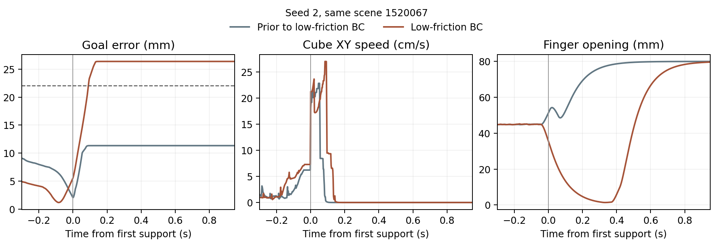
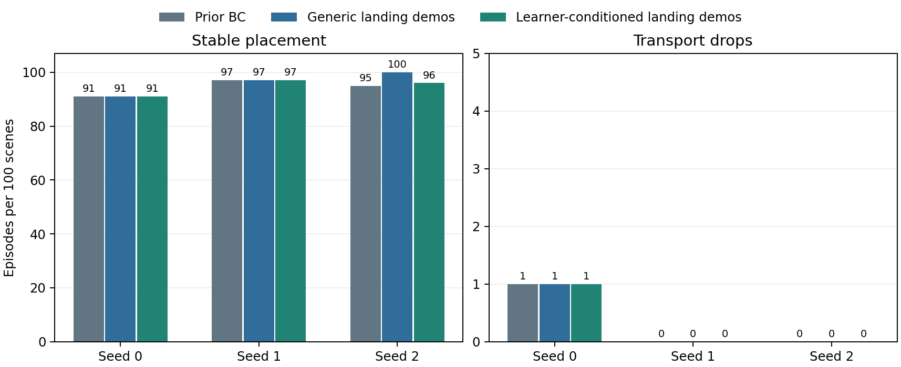

# Seed 2 的落桌滑移与边缘补示范

## 掉落减少后，放置为何下降

在 70% 指尖–方块滑动摩擦和 150 g 条件下，上一轮 seed 2 的运输掉落由 4/100 减少到 1/100，稳定放置却由 96/100 降至 93/100。同场景配对有 2 次稳定放置恢复、5 次从成功变为失败。5 次回退包括 1 次新的运输掉落和 4 次落桌后的越界。除新回退外，另有 2 个未恢复场景出现同样的落桌越界。

在这 4 次新越界中，方块第一次由桌面承重时，离目标中心仅 **1.9–5.5 mm**。随后在 **78–92 ms** 内滑出 22 mm 的目标圈，最终误差为 **22.7–26.4 mm**。完全张开且双指脱离方块发生在首次承重后 **0.57–0.80 秒**，误差在完全松爪后基本固定。回放显示，减掉的运输损失被新增的落桌滑移抵消了一部分。样本定位了越界时刻，具体碰撞的力学来源仍未单独隔离。

| 诊断动作 | 原 5 个回退中恢复稳定 | 原 2 个持续失败中恢复稳定 | 原 7 个稳定对照仍成功 |
|---|---:|---:|---:|
| 原补示范 BC | 0/5 | 0/2 | 7/7 |
| 到达后、首次落桌前修正 XY | 2/5 | 1/2 | 7/7 |
| 同阶段负 Z 动作减半 | 0/5 | 0/2 | 5/7 |
| 同阶段保持完全闭爪 | 2/5 | 1/2 | 7/7 |

配对回放另外包括 2 个从原失败恢复的场景。诊断动作只在已合格搬运到目标后介入，旧回放逐条核对终止步数、运输掉落、稳定与严格成功。部分恢复支持重新收集对准与落桌轨迹。单独减慢下降未挽回原回退，反而损失两个稳定对照。

[落桌事件](../results/place_edge/diagnosis/landing_events.csv) · [配对探针汇总](../results/place_edge/diagnosis/summary.csv) · [逐物理步记录](../results/place_edge/diagnosis/physics_trace.csv)

## 同预算示范与验证协议

每个训练 seed 从上一轮补示范 BC 的同一份冻结检查点出发。新采数据的每个回合有两个片段。首次夹持方块进入放置区前，普通组由专家执行，边缘组由当前学习策略执行。从首次到达起，两组都交给同一个专家。专家重新向目标中心对准，确认夹持触桌后释放并撤离。两组每 seed 各花 **6,000 次新增环境交互**，包括前缀、失败尝试和最后截断的回合。监督更新只采纳完整成功回合的专家后缀，并混合上一轮两批低摩擦全轨迹来保留运输行为。边缘组的策略前缀没有作为专家标签参与拟合。

两组使用相同的采集场景序列、两层 128 单元的 BC 网络和学习率 0.00015。尝试 250、750、1,500 次更新。从独立的 24 个验证场景选检查点。选择优先保住起点策略的掉落数，再比较稳定放置数和掉落数，平分时取更新较少的权重。保守规则可以选回原权重。另行使用固定 250 次更新的检查点，在三个 seed 都检验实际完成监督更新的效果。两套结果使用相同的数据预算与 100 个全新测试场景 1530000–1530099。所有测试由 BC 直接输出动作。稳定放置仍以 22 mm 半径、撤离后连续稳定 1 秒为准，同时记录严格夹持触桌、合格抬升、运输掉落和落点误差。

[示范预算与后缀核对](../results/place_edge/demo_audit.csv) · [复现说明](../README.md)

## 验证选模后的独立测试

| 方法 | 稳定放置（seed 0／1／2） | 运输掉落（seed 0／1／2） | 严格触桌并放置 | 落点误差中位数／P90 |
|---|---:|---:|---:|---:|
| 冻结上一轮 BC | 283/300（91／97／95） | 1/300（1／0／0） | 183/300 | 5.50／19.44 mm |
| 普通专家补示范 | 288/300（91／97／100） | 1/300（1／0／0） | 198/300 | 4.49／17.24 mm |
| 学习策略到达边缘后补示范 | 284/300（91／97／96） | 1/300（1／0／0） | 197/300 | 4.50／18.96 mm |

每组的 300 个回合都合格抬升。两种方案在 seed 0 和 seed 1 都被验证规则选回原权重。seed 2 的两个方案均选中 250 次更新权重。普通补示范在 seed 2 挽回了全部 5 个原失败，100 个同场景回合没有回退。边缘补示范挽回 3 个，同时出现 2 个新失败，净增 1 次稳定放置。两种方案的运输掉落与原基线相同。相应的严格触桌成功数也单列，主指标仍为稳定放置。

[独立测试汇总](../results/place_edge/comparison.csv) · [逐 seed 场景配对](../results/place_edge/paired.csv)

## 三个 seed 固定进行 250 次更新

| 方法 | 稳定放置（seed 0／1／2） | 运输掉落（seed 0／1／2） | 严格触桌并放置 |
|---|---:|---:|---:|
| 冻结上一轮 BC | 283/300（91／97／95） | 1/300（1／0／0） | 183/300 |
| 普通专家补示范 | 289/300（100／89／100） | 10/300（0／10／0） | 243/300 |
| 学习策略到达边缘后补示范 | 284/300（94／94／96） | 6/300（0／6／0） | 235/300 |

固定更新下，两个方案都消除了 seed 0 的一次掉落，同时在 seed 1 引入了新的掉落。各组仍有 300/300 次合格抬升。两种采集方法的跨 seed 效果都依赖检查点选择。按这次验证规则，普通补示范在不增加测试掉落的情况下提高了稳定放置。学习策略到达边缘后补示范也保住掉落并增加一次稳定成功，收益小于等预算普通示范。该结果限定于 70% 摩擦、150 g 方块及本次专家接管方式。

[固定更新汇总](../results/place_edge/fixed_250_comparison.csv) · [固定更新配对](../results/place_edge/fixed_250_paired.csv) · [20 项测试日志](../results/place_edge/verification.txt)

## 同场景边缘放置视频

独立场景 1530091 中，冻结策略完成运输，方块最终停在距目标中心 23.8 mm 的位置，越过 22 mm 半径。边缘补示范策略在同场景把终点误差降到 15.2 mm，通过严格触桌与连续 1 秒的稳定放置。两条视频都复核了运输掉落、稳定判定、严格判定、终止步数和帧数。

[原策略落点越界](../results/place_edge/videos/frozen_previous_seed_2_1530091.mp4) · [补示范后稳定放置](../results/place_edge/videos/edge_landing_seed_2_1530091.mp4) · [视频核验](../results/place_edge/videos/criteria.json)

