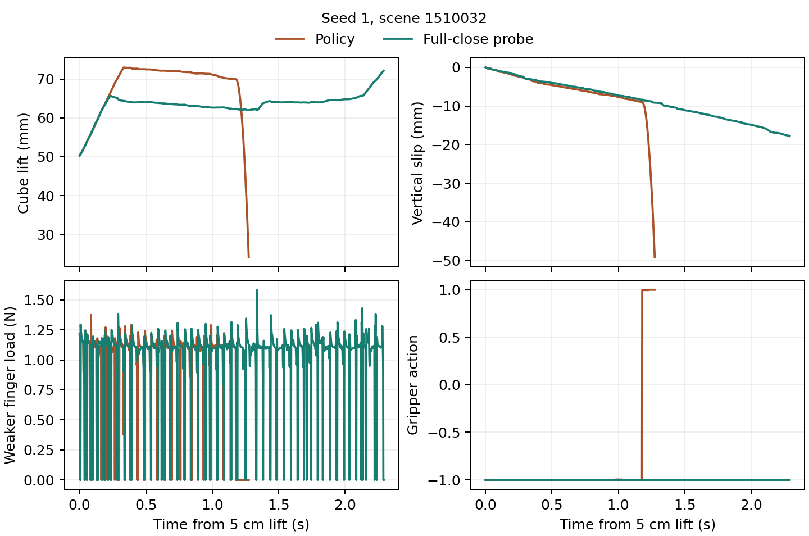
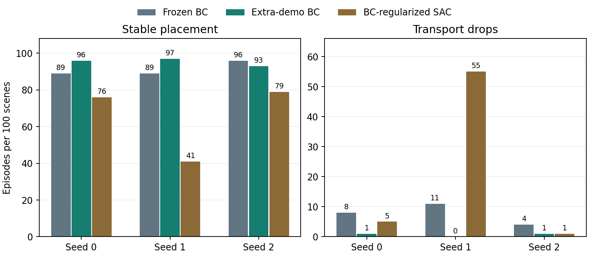

# 低摩擦下的运输掉落与同预算微调

## Seed 1 的掉落机制

在 70% 指尖–方块滑动摩擦、150 g 方块下，选取 seed 1 上一批测试中的全部 17 次运输掉落及按场景编号排列的前 17 次稳定放置。用冻结权重重放，并按 2 ms 的物理步保存双指法向载荷、两指开度、方块相对夹爪的位移和策略动作。未干预回放的终止步数、严格与稳定结果、掉落标记和失败阶段均与存档吻合。同步检查同一 seed 在 75% 摩擦及 seed 2 在 70% 摩擦时的同场景结果。

17 次原掉落中，15 次在到达目标前发出明显松爪指令。这里将归一化夹爪动作大于 −0.5 记为明显松爪指令，即目标开度超过全行程的 25%。在首次发出该指令之前，方块相对夹爪已下滑 **7.7–16.3 mm**，中位数 **10.8 mm**。其余两个回合始终小于该指令阈值，末次有效夹持时方块已下滑约 24–25 mm，下降到桌面附近。短时法向载荷波动也出现在成功回合，因此用放松指令、滑移和最终掉落的时序一起判断。

| 诊断回放 | 原 17 个掉落场景中的稳定放置 | 其中运输掉落 | 原 17 个稳定场景仍稳定 |
|---|---:|---:|---:|
| seed 1 原策略，70% 摩擦 | 0/17 | 17/17 | 17/17 |
| 合格抬升后强制完全闭爪 | 15/17 | 2/17 | 17/17 |
| 运输中的 XY 动作减半 | 0/17 | 17/17 | 0/17 |
| 低于 7.2 cm 时增加向上指令 | 13/17 | 2/17 | 16/17 |
| seed 1 原策略，75% 摩擦 | 16/17 | 1/17 | 17/17 |
| seed 2 原策略，70% 摩擦 | 17/17 | 0/17 | 17/17 |

对照表包含所有已知掉落及等量抽取的成功回合，表中通过数用于衡量同场景干预，整体通过率由独立测试估计。干预只在合格抬升后且仍在到达目标前生效。证据指向低摩擦下的滑移和闭爪保持不足共同导致掉落。保持闭爪能挽回大多数回合，但方块仍可能在夹爪内滑动。放慢水平动作这次没有保住抓持。增高指令减轻了部分运输掉落，同时也让一个原成功场景回退。训练和独立评估均直接执行策略输出。

[诊断汇总](../results/place_low_friction/diagnosis/summary.csv) · [17 个掉落的事件顺序](../results/place_low_friction/diagnosis/slip_events.csv) · [逐物理步轨迹](../results/place_low_friction/diagnosis/physics_trace.csv)

## 同预算训练协议

三个 seed 各自从同一份已核验的冻结 BC 检查点出发。冻结 BC 是零新增交互基线。其余两组各用 **6,000 步**，包括失败演示和预算截断的演示。演示用确认夹持触桌的专家在 70% 摩擦、150 g 条件下采集。两个训练组共用每个 seed 的前 2,000 步示范，后续预算分配如下。

| 方法 | 新示范步 | 新在线步 | 更新 |
|---|---:|---:|---|
| 冻结纯 BC | 0 | 0 | 直接执行原权重 |
| 补示范 BC | 6,000 | 0 | 与原四条件演示混合监督训练，1,500 次更新 |
| BC 正则 SAC | 2,000 | 4,000 | 前 2,000 步填入 replay buffer，也用于相位均衡的 BC 正则。在线 SAC 每 4 步更新 2 次 |

SAC 使用原抓放融合奖励和 44 维观测，沿用两层 128 单元的 ReLU actor，移植 BC 隐层和确定性均值，独立初始化方差、双 critic 和目标网络。BC 正则权重为 20。两组采用事先固定的终点检查点，验证曲线只用于观察变化。评估和视频另行运行，训练预算只计用于训练的新增环境交互。独立测试在 1520000–1520099 上固定起点和目标。主指标为稳定放置及运输掉落，附列合格抬升和严格触桌。稳定放置要求夹持搬到目标区后释放、撤离，且方块连续稳定至少 1 秒。严格口径另外要求夹持触桌。

初始 actor 的直接 tanh 输出在复核的 BC 轨迹上逐元素一致。SB3 通用 `predict` 路径对本环境的 [−1, 1] 动作界仍执行一次浮点换算，最大差异约 6×10⁻⁸。微小差异会在接触动力学中传播，36 个初始化验证回合里，有 3 个回合的稳定放置判定随执行路径改变。SAC 训练曲线保留标准 SB3 路径。正式三组对照统一读取确定性 tanh 动作，并用该路径重放视频。 [动作精度复核](../results/place_low_friction/initial_actor_precision.csv)

## 三个训练 seed 的独立测试

| 方法 | 合格抬升 | 运输掉落（seed 0／1／2） | 稳定放置（seed 0／1／2） | 严格触桌并放置 |
|---|---:|---:|---:|---:|
| 冻结纯 BC | 300/300 | 23/300（8／11／4） | 274/300（89／89／96） | 169/300 |
| 补示范 BC | 300/300 | 2/300（1／0／1） | 286/300（96／97／93） | 177/300 |
| BC 正则 SAC | 282/300 | 61/300（5／55／1） | 196/300（76／41／79） | 146/300 |

补示范 BC 避免了冻结基线的全部 23 次运输掉落，同时新增 2 次。它在同场景中恢复 20 次稳定放置，另有 8 次回退，净增 12 次。**Seed 1 从 11 次运输掉落降到 0 次，稳定放置从 89 次增至 97 次。** Seed 2 的运输掉落由 4 次降至 1 次，稳定放置由 96 次降为 93 次。补示范后 seed 2 有 6 次未稳定放置的回合已经搬到目标附近，结束位置越出 22 mm 目标半径，误差为 22.2–26.4 mm。运输改进和放置落点分别影响最终通过数。

BC 正则 SAC 的训练早期，三个 seed 的验证稳定放置由 11／10／12 次降至 3／0／3 次，4,000 在线步时回升为 8／8／8 次。独立测试中，seed 1 合格抬升 97 次，其中 55 次运输掉落。seed 0 的掉落由 8 次降至 5 次，但合格抬升由 100 次降至 85 次。按已抬升回合为分母，三种方法的运输掉落分别为 23/300、2/300、61/282。这组结果表明 SAC 微调在当前预算和设置下未稳定保留原 BC 的抓取与搬运动作。BC 正则权重、在线步分配和 replay 设计属于本次配方，未进行独立消融。

补示范 BC 每 seed 采集约 21 秒，38–40 条完整成功示范用于拟合，优化约 7.3 秒。BC 正则 SAC 每 seed 采集约 7 秒，线上训练约 29–30 秒。时间来自单线程并发实验，单列的训练时间排除了验证回放。同样的新增交互成本下，把预算用于目标条件示范，在本次低摩擦抓放中取得了更低的运输掉落和更高的稳定放置率。

[三个训练 seed 的汇总与成本](../results/place_low_friction/comparison.csv) · [同场景得失](../results/place_low_friction/paired.csv) · [测试日志](../results/place_low_friction/verification.txt) · [复现命令](../README.md)

## 同场景视频

选取 seed 1 中基线发生运输掉落、补示范后稳定放置，且基线末态距目标最远的场景 1520073。冻结 BC 在运输时掉落，末态距目标中心约 10.1 cm。补示范 BC 完成夹持触桌和稳定放置，末态误差约 1.2 cm。两个视频均用原评估动作路径重放，并复核了判据、终止步数及帧数。

[冻结 BC 运输掉落](../results/place_low_friction/videos/transport_drop_seed_1_1520073.mp4) · [补示范 BC 稳定放置](../results/place_low_friction/videos/stable_recovery_seed_1_1520073.mp4) · [视频判据核验](../results/place_low_friction/videos/criteria.json)
