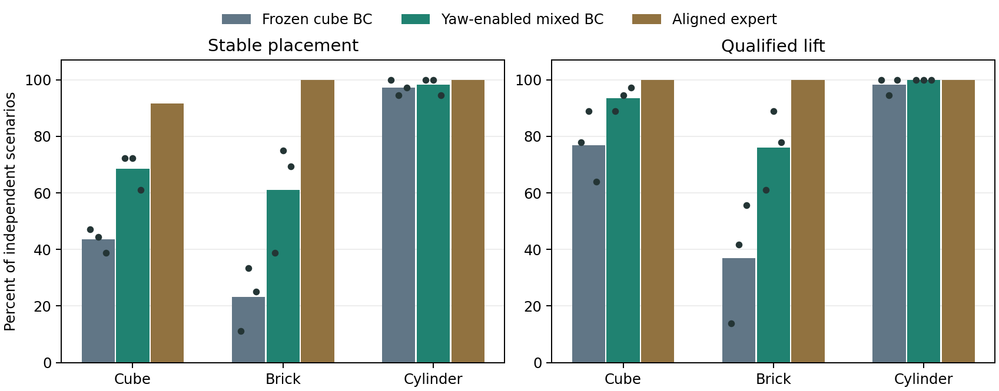

# 多物体与随机初始朝向的抓放实验

## 任务条件

同一张桌上比较 45×45×45 mm 方块、58×32×45 mm 长方块、直径和高度均为 45 mm 的圆柱。质量统一为 150 g，指尖滑动摩擦为名义值的 70%，桌面摩擦保持原参数。长方块和圆柱按均匀质量分布换算惯量。每次重置随机采样物体和目标 XY。随机朝向只改变物体绕世界竖轴的初始偏航，范围为 −90° 至 90°。目标仍是抓起 5 cm、搬运到半径 22 mm 的目标区、释放并撤离，让物体在桌面连续稳定 1 秒。严格触桌判据单列。任务允许物体以任意朝向稳定放置。

新增 `PandaObjectPlace-v0`。学习策略从原 44 维观测扩展到 52 维，加入物体的对称性编码偏航、手腕相对偏航、物体半尺寸和圆柱标记。偏航动作追加到原动作末尾，策略输出 `[dx, dy, dz, gripper, dyaw]`，每步最大偏航增量 0.08 rad。六维 IK 维持俯仰和横滚并执行策略给出的平移和偏航。闭爪、抬升与放置由策略决定。专家的对准和动作切换只用于采集与对照。运行时方块按模拟接触和摩擦自由运动。旧的 `PandaPickPlace-v0` 沿用 44 维观测和四维动作。

## 物体与朝向初筛

每一行的四种方法共享 16 个独立起点和目标。零朝向和随机朝向对照使用同一策略与物理条件。冻结策略为上一轮运输动作约束 BC 的 seed 1。

| 物体 | 冻结 BC，零朝向 | 冻结 BC，随机朝向 | 固定腕向专家，随机朝向 | 腕向对准专家，随机朝向 |
|---|---:|---:|---:|---:|
| 方块 | 16/16 | 4/16 | 7/16 | 14/16 |
| 长方块 | 16/16 | 2/16 | 3/16 | 0/16（沿短轴夹） |
| 圆柱 | 16/16 | 16/16 | 16/16 | 16/16 |

长方块沿短轴夹时，16 次都有双指接触，只有 3 次合格抬升，均在运输时掉落。把夹爪张合方向改为沿长方块长轴，两指夹住长方块两端的短边面，原场景恢复到 16/16，并在另外 16 个独立场景达到 16/16。保持零平移、零偏航和完全闭爪的静态探针记录到，短轴与长轴的弱侧法向力中位数分别为 **0.80 N 和 1.45 N**，对应两指实际开度约 32.0 mm 和 58.0 mm。结果支持当前联动位置伺服下，沿长轴夹持具有更大的法向载荷和抗滑余量。圆柱在水平截面上没有需要对齐的几何轴，随机偏航造成的退化在这组实验中很小。

[初筛逐组数据](../results/place_objects/screen.csv) · [长轴独立确认](../results/place_objects/brick_axis/confirmation/summary.json) · [静态夹持力对照](../results/place_objects/brick_axis/static_grip_probe.csv) · [训练域选择](../results/place_objects/selection.json)

## 混合 BC 训练与独立评估

各物体的入选门槛为对准型专家至少稳定放置 13/16。长方块使用长轴方案的独立确认，因此三种物体均纳入训练。三个训练 seed 分别从同 seed 的冻结运输约束 BC 权重初始化。首层新增输入列和偏航头初始为零，移植核对原四维输出。每 seed 为三种物体各采 3,000 个示范交互步，共 9,000 步，失败与截断也计入预算。三个几何来源均衡抽样，只对完整成功记录拟合专家动作。训练使用 2,000 次离线更新，检查点在每种物体 12 个独立验证场景中选取。选模先比较最弱物体的稳定放置数，再比较总成功数和运输掉落。

独立测试每种物体 36 个场景，三种几何的场景编号互斥。三组 seed 在相同的 108 个随机位置与朝向上评估。冻结 BC 保持原固定腕向，混合 BC 学习偏航。训练后用同一混合权重对方块和长方块各 12 个已锁定测试场景关闭偏航动作，其余输出照常执行。这个配对干预衡量执行偏航对结果的贡献。新实验对比覆盖训练中见过的三种几何及未见过的场景和初始角度。

## 独立测试结果

| 物体 | 冻结 BC 稳定放置 | 混合 BC 稳定放置（seed 0／1／2） | 对准专家稳定放置 | 冻结 BC → 混合 BC 的运输掉落 |
|---|---:|---:|---:|---:|
| 方块 | 47/108 | 74/108（26／26／22） | 33/36 | 23 → 17 |
| 长方块 | 25/108 | 66/108（14／27／25） | 36/36 | 14 → 11 |
| 圆柱 | 105/108 | 106/108（36／36／34） | 36/36 | 0 → 0 |
| 合计 | 177/324 | 246/324 | 105/108 | 37 → 28 |

混合 BC 在 324 次回放中合格抬升 291 次，冻结 BC 为 229 次。长方块的合格抬升由 40/108 增至 82/108。长方块的稳定放置仍是三种几何中最低的，seed 0 尤其弱。圆柱的稳定放置基本保持，严格触桌指标由 83/108 降至 69/108。混合 BC 总计严格成功 168/324，冻结 BC 为 128/324。三个 seed 分别使用 1,300、2,000、700 次更新的验证检查点。每个 seed 的 9,000 个示范步中包含 50–54 条完整成功轨迹。

[逐形状和 seed 的结果](../results/place_objects/comparison.csv) · [示范预算、动作和回合核验](../results/place_objects/demo_audit.csv)

## 关闭腕部偏航的配对干预

| 物体 | 执行偏航时稳定放置 | 偏航动作置零时稳定放置 | 执行偏航时合格抬升 | 偏航动作置零时合格抬升 |
|---|---:|---:|---:|---:|
| 方块 | 21/36 | 18/36 | 34/36 | 32/36 |
| 长方块 | 21/36 | 9/36 | 24/36 | 15/36 |

以第一次在物体附近闭爪时的实际手腕朝向计算，执行偏航的长方块夹持轴偏差中位数为 9.5°，偏航置零后为 54.2°。方块的相应数值为 11.8° 和 33.2°。长方块的配对证据支持偏航动作在抓取对准和抬升中发挥了实际作用。方块的稳定放置净收益较小，且仍可通过减少抬升后的掉落进一步改善。当前测试覆盖三个已见几何和随机初始偏航，未估计其他几何、任意三维初始姿态或指定最终放置朝向的成功率。

[同权重关闭偏航的逐 seed 结果](../results/place_objects/wrist_yaw_ablation.csv) · [22 项测试记录](../results/place_objects/verification.txt) · [复现命令](../README.md)

## 同场景视频

场景 1553008 的长方块初始偏航为 50.7°。固定腕向的冻结策略在运输时掉落，末态距离目标约 23.3 cm。混合 BC 在抓取前转动手腕，完成合格抬升、夹持触桌和连续 1 秒的稳定放置，末态误差为 11.4 mm。重放已核验动作路径、运输结果、两种放置判据和视频帧数。

[固定腕向掉落](../results/place_objects/videos/brick_frozen_seed_2_1553008.mp4) · [混合 BC 稳定放置](../results/place_objects/videos/brick_mixed_seed_2_1553008.mp4) · [视频核验](../results/place_objects/videos/criteria.json)
