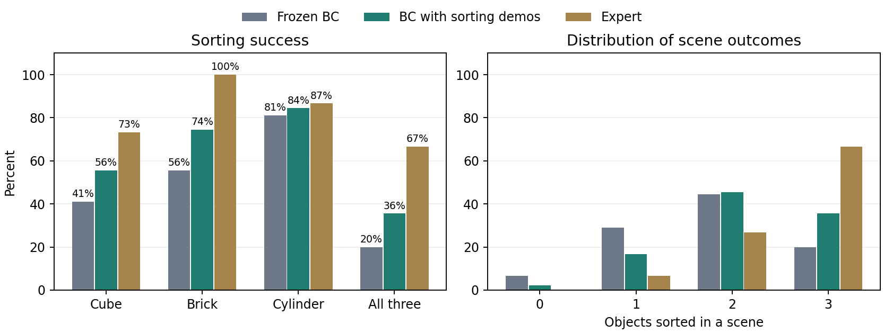

# 三物体分拣的专家补示范

## 采集与预算

本轮在三个物体同时存在、彩色实体托盘带围边的同一仿真场景中采集示范。目标颜色和形状的对应关系沿用上一轮。每件任务沿用原有的接触、合格抬升和连续稳定放置判据。每个训练 seed 采集 24 个独立场景，实际尝试 72 件。抓取顺序、颜色托盘位置、物体位置和朝向随场景变化。三件物体在每个场景中持续共享同一份 MuJoCo 状态。

采集用上一轮的对准专家，沿原评估执行路径跑完整桌。每个物体单独记录 52 维观测、5 维专家动作、后继观测、奖励、自然终止与限时截断标志和专家动作阶段。完整成功且整桌结束时依然在正确托盘内的轨迹参与新一轮监督训练。未通过的尝试随档案保留。每件之间的物理回程控制步单独记录。

三组补示范使用对应 seed 的冻结混合 BC 初始化。将三种物体的新场景示范和原三种单物体示范混合，各来源每批等量抽样，保持原观测和动作空间。训练最多 1,300 次 PyTorch BC 更新，学习率为 0.00025。训练全程离线，沿用上一轮的二值接触观测。验证集每个 seed 共用 10 个场景。在圆柱成功数不低于该 seed 初始值的检查点中，依次按三件全对数、单件分对数和运输掉落数选择。平分时保留更新较少的检查点。

## 测试协议

冻结 BC、补示范 BC、专家使用配对的新场景 1563000–1563029。验证和采集场景与这一批测试互斥。三个训练 seed 分别回放这 30 个场景。三件全对是主指标，同时报告单件成功、合格抬升、运输掉落和实际错盘。两组 BC 都直接输出抓放动作，由同一任务程序提供目标与每件之间的回程。

## 采集结果与选模

| 训练 seed | 成功示范件数 | 专家抓放步数 | 其中用于监督训练 | 回程步数 | 选定更新次数 |
|---|---:|---:|---:|---:|---:|
| 0 | 57/72 | 12,655 | 9,055 | 3,173 | 1,300 |
| 1 | 65/72 | 11,896 | 10,295 | 3,213 | 700 |
| 2 | 61/72 | 12,298 | 9,658 | 3,187 | 250 |
| 合计 | 183/216 | 36,849 | 29,008 | 9,573 | — |

三个 seed 共采集 72 个独立示范场景。专家抓放和回程共执行 46,422 个控制步，计入所有尝试。三组实际优化各运行约 7 秒，验证回放另计。旧单物体示范继续参与监督训练，成本属于上一轮的既有数据。

[专家数据预算、轨迹计数与 SHA-256](../results/place_sorting_bc/demo_audit.csv)

## 独立场景结果

| 分拣指标 | 原冻结 BC | 补示范 BC | 同场景专家 |
|---|---:|---:|---:|
| 方块进红盘 | 37/90 | 50/90 | 22/30 |
| 长方块进蓝盘 | 50/90 | 67/90 | 30/30 |
| 圆柱进绿盘 | 73/90 | 76/90 | 26/30 |
| 单件分对 | 160/270（59.3%） | 193/270（71.5%） | 78/90（86.7%） |
| 三件全对 | 18/90（20.0%） | 32/90（35.6%） | 20/30（66.7%） |
| 运输掉落 | 37/270 | 29/270 | 0/90 |

整桌以同一批场景配对，补示范后 23 次从失败变为成功、9 次回退，净增 14 次全对。单件共有 54 次恢复、21 次回退，净增 33 次。三组 seed 的整桌结果分别从 4、10、4 次增至 9、12、11 次。冻结与补示范策略均有 0 次错误颜色的末态停放。

长方块的合格抬升从 63/90 增到 74/90，是单件成功增幅最大的形状。方块运输掉落由 28 次降为 22 次，仍是整桌成功率的主要瓶颈。圆柱单件成功增加 3 次，但 seed 0 单独退回 1 次。总运输掉落降了 8 次，seed 0 的跨形状掉落从 6 次增到 10 次。这些回退表明补示范提高了总体成功率，各场景的运输可靠性仍有差异。

[逐 seed 汇总](../results/place_sorting_bc/comparison.csv) · [分形状指标](../results/place_sorting_bc/by_shape.csv) · [同场景得失](../results/place_sorting_bc/paired.csv) · [失败阶段](../results/place_sorting_bc/failure_stages.csv) · [24 项测试](../results/place_sorting_bc/verification.txt) · [复现命令](../README.md)

## 同一场景的补训前后回放

场景 1563029 的两段回放使用 seed 1 对应的冻结和补示范权重，物体、托盘、顺序和起点配对。冻结策略只通过了长方块入蓝盘。方块抬升不足。圆柱末态在绿盘，但当次操作的撤离后连续稳定判据未通过，稳定计时为 0 秒。补示范策略的三件均在对应托盘持续稳定 1 秒，并在整桌结束时通过复查。

[补训前分对一件](../results/place_sorting_bc/videos/frozen_seed_1_scene_1563029_1of3.mp4) · [补训后三件全对](../results/place_sorting_bc/videos/adapted_seed_1_scene_1563029_3of3.mp4) · [逐件视频核验](../results/place_sorting_bc/videos/criteria.json)
