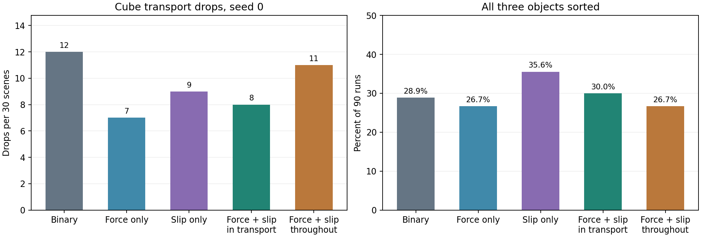

# 彩色托盘分拣的力、滑移与运输阶段消融

## 对照设计

五组均采用行为克隆（BC）。接触开关基线保留原 52 维观测，包括每个指尖以 0.15 N 为阈值的接触信号。增强组沿用这些输入，只改变传入额外投影的观测。

| 组别 | 额外观测 | 额外观测可用时段 |
|---|---|---|
| 接触开关 | 无 | 无 |
| 仅连续力 | 左右指尖法向力各 1 维 | 全程 |
| 仅滑移 | 手爪坐标系中的物体相对平移速度与累计位移，各 3 维 | 全程 |
| 仅运输时加力和滑移 | 上述两类，共 8 维 | 首次合格抬升后至首次合格运抵前 |
| 全程加力和滑移 | 上述两类，共 8 维 | 全程 |

运输窗口使用原观测已有的抬升和运抵标记，训练和评估执行同一遮罩。遮罩只控制额外输入，BC 训练仍可更新共享网络，运输窗口外的动作也可能随之改变。所有组均由学习策略输出末端三轴增量、夹爪开合和腕部偏航增量。IK 与关节伺服执行策略给出的运动，夹持、投放和掉落由接触动力学产生。当前滑移特征是仿真中由物体位置计算的平移代理。

每个 seed 沿用同一初始权重、同一批专家示范、同一采样序列和学习率 0.00025。二值组和全程双信号组使用已核验的历史检查点，三个新组从匹配的初始权重训练。优化次数在同一 seed 内一致，沿用此前独立确定的预算，未根据本轮测试选模。三个 seed 合计复用了 63,849 条记录，新增示范场景和在线训练交互均为零。

| Seed | 每组优化更新次数 | 示范记录 |
|---|---:|---:|
| 0 | 1,300 | 21,655 |
| 1 | 700 | 20,896 |
| 2 | 250 | 21,298 |

[预算及历史检查点哈希](../results/place_sorting_contact_ablation/budget.csv) · [上轮示范重放和核对](place_sorting_contact_report.md) · [复现命令](../README.md#连续力与滑移的分项及运输阶段消融)

## 同场景评估

所有模型都在此前未用于训练、验证或评估的 30 个场景（1565000–1565029）上测试。逐场景对齐托盘颜色、物体位置与朝向、执行顺序和初始布局。每组执行 90 桌次，共计 450 桌次、1,350 次物体尝试。合格抬升要求达到 5 cm，运输掉落使用物理松脱判据。放置通过要求合格运抵、释放、手爪撤离、托盘内稳定保持 1 秒，并在整桌结束时仍留在正确托盘。

### Seed 0

| 组别 | 方块合格抬升 | 方块运输掉落 / 合格抬升 | 方块分对 | 三件全对 |
|---|---:|---:|---:|---:|
| 接触开关 | 25/30 | 12/25（48.0%） | 12/30 | 4/30（13.3%） |
| 仅连续力 | 24/30 | **7/24（29.2%）** | 15/30 | 6/30（20.0%） |
| 仅滑移 | 26/30 | 9/26（34.6%） | 13/30 | **10/30（33.3%）** |
| 仅运输时加力和滑移 | 26/30 | 8/26（30.8%） | **17/30** | 9/30（30.0%） |
| 全程加力和滑移 | 26/30 | 11/26（42.3%） | 13/30 | 6/30（20.0%） |

仅滑移新增 6 桌全对，保住了基线的全部 4 桌全对。方块有 5 个场景避免掉落、2 个场景新增掉落，合格抬升增加 1 次。方块分对从 12 增到 13，长方块从 17 增到 23，圆柱从 23 增到 25，整桌提升伴随另外两类物体分对改善。

双信号在运输阶段启用时，合格抬升次数与全程双信号组相同，方块少掉 3 次，方块分对多 4 次，整桌多成功 3 次。相较接触开关，这组避免了 6 次掉落并新增 2 次，整桌有 7 次从失败变成功、2 次从成功变失败。

### 三个 seed 汇总

| 组别 | 方块运输掉落 / 合格抬升 | 方块分对 | 三件全对 | 各 seed 三件全对（各 30 桌） |
|---|---:|---:|---:|---:|
| 接触开关 | 30/78（38.5%） | 44/90 | 26/90（28.9%） | 4、14、8 |
| 仅连续力 | **23/80（28.8%）** | 47/90 | 24/90（26.7%） | 6、13、5 |
| 仅滑移 | 31/85（36.5%） | 46/90 | **32/90（35.6%）** | 10、15、7 |
| 仅运输时加力和滑移 | 28/83（33.7%） | **50/90** | 27/90（30.0%） | 9、12、6 |
| 全程加力和滑移 | 30/84（35.7%） | 47/90 | 24/90（26.7%） | 6、11、7 |

- **连续力最能降低方块掉落。** 三个 seed 的掉落次数均降低，合计少 7 次。长方块分对由 61/90 降到 57/90，整桌少 2 次。
- **滑移取得最高整桌全对率。** 三个 seed 合计多 6 桌成功，主要增益来自 seed 0。合格抬升增加 7 次，掉落增加 1 次，抬升后的掉落率从 38.5% 降到 36.5%。Seed 1 和 2 都各自多掉 2 次方块。
- **仅运输时启用双信号获得最多方块成功。** 相对全程双信号，合计少掉 2 次，多分对 3 次，多成功 3 桌。相对接触开关组，seed 0 整桌多通过 5 桌，seed 1 和 2 各少通过 2 桌。合计整桌只净增 1 桌。

本轮结果支持将连续力作为减少方块运输掉落的候选，将仅滑移作为提高整桌成功率的候选。三个训练 seed 共享 30 套初始布局，上表中的 90 次结果含跨 seed 的布局复用，且收益依赖训练 seed。现有样本尚不足以确认双信号阶段限定能稳定兼顾两项指标。

[逐 seed 指标](../results/place_sorting_contact_ablation/by_seed.csv) · [按物体指标](../results/place_sorting_contact_ablation/by_shape.csv) · [逐场景配对得失](../results/place_sorting_contact_ablation/paired.csv) · [失败阶段计数](../results/place_sorting_contact_ablation/failure_stages.csv) · [27 项测试结果](../results/place_sorting_contact_ablation/verification.txt)

## Seed 0 配对回放

场景 1565004 中，接触开关组的方块在运输中脱离夹爪，最终停在红盘里。由于这次未夹持运抵，稳定放置计时为 0 秒，整桌为 2/3。仅滑移组在同场景夹持运抵、释放并稳定保持 1 秒，整桌为 3/3。两段回放与原评估逐件核对。

[接触开关回放](../results/place_sorting_contact_ablation/videos/binary_seed_0_scene_1565004_2of3.mp4) · [仅滑移回放](../results/place_sorting_contact_ablation/videos/slip_seed_0_scene_1565004_3of3.mp4) · [逐件视频判据](../results/place_sorting_contact_ablation/videos/criteria.json)
