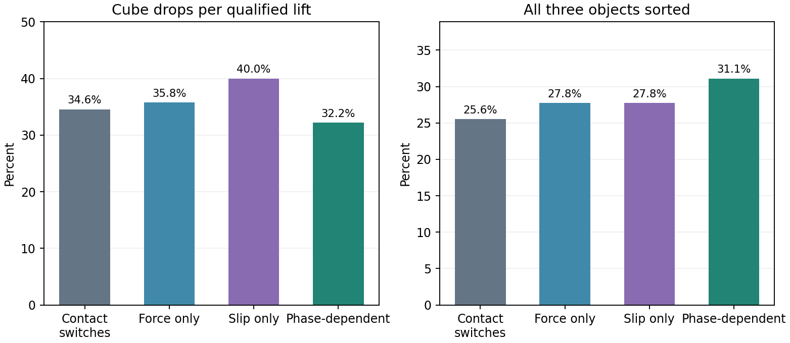

# 分阶段触觉与方块掉落诊断

## 上轮仅滑移 BC 的方块掉落

使用上轮同场景对照（1565000–1565029）。合格抬升指双指夹持方块达到桌面静止位置以上 5 cm。运输掉落指已经合格抬升、尚未合格运抵目标时，方块失去两侧手指接触，并受到桌面支撑或降到静止位置以上 2.5 cm 以下。

| Seed | 接触开关掉落 / 合格抬升 | 仅滑移掉落 / 合格抬升 | 两组均合格抬升的场景 | 在共同抬升场景中掉落变化 |
|---|---:|---:|---:|---:|
| 1 | 8/27（29.6%） | 10/29（34.5%） | 26 | 7 → 9 |
| 2 | 10/26（38.5%） | 12/30（40.0%） | 26 | 10 → 9 |

每个 seed 都有 5 个新增掉落场景和 3 个避免掉落场景。Seed 2 的 5 个新增掉落中，3 个来自接触开关组没有抬起来的场景。Seed 1 对应数字是 1 个。只看两组均抬起来的布局，seed 1 的运输退化仍在，seed 2 的掉落次数反而少 1 次。这是按共同观测到的抬升做的描述性比较。

在两个 seed 的 16 个配对结果不同的场景中，逐件复核接触开关、仅滑移和仅连续力的原始回合，共 48 次原策略重放。对 10 个新增掉落场景追加 40 次诊断重放。物理子步记录夹持法向力、物体相对手爪位移、夹爪实际间距、夹爪动作和其他物体碰撞。

- 10 次中有 8 次在最后完全脱离双指时，夹爪动作仍约为 −1（全闭）。有 4 次在最终脱手前与桌上另一件物体接触，接触时序可在子步日志中复核。
- 首次短暂低于双指夹持阈值发生在合格抬升后 2–34 ms，7 次早于第一次采用运输阶段观测的动作。共同抬升的 6 个基线对照也出现过短暂丢失双指夹持。最后一次脱离所有手指接触发生在抬升后 0.89–2.80 s，首次短暂失稳单独不足以判定掉落。
- 运输期锁定全闭仅让 1/10 个方块完成合格放置。运输期水平动作减半让 2/10 避免掉落并合格运抵，其中 1 个完成放置。
- 方块抬升前临时换成接触开关策略，抬升后切回同一个仅滑移策略，有 4/10 个方块完成合格放置，另有 3 个未抬升。仅在抬升前置零滑移通道、保持原模型，有 4/10 个方块避免掉落并合格运抵，其中 3 个完成合格放置，另有 3 个未抬升。两种干预表明抬升前的输入和动作足以改变部分场景的后续结果。这两项是针对旧失败场景的干预，只有同样合格抬升并运抵才计入救回。

[10 个新增掉落的时序和干预结果](../results/place_sorting_contact_phase/diagnosis/loss_mechanisms.csv) · [Seed 1 物理子步](../results/place_sorting_contact_phase/diagnosis/seed_1/physics_trace.csv) · [Seed 2 物理子步](../results/place_sorting_contact_phase/diagnosis/seed_2/physics_trace.csv)

## 分阶段触觉的独立测试

分阶段组保留原 52 维观测及接触开关。首次合格抬升后至首次合格运抵前，额外输入只有左右指连续法向力。在其余时段，额外输入只有手爪坐标系下的相对滑移速度和累计位移。训练和评估都用相同的观测遮罩；每组运动和开合仍由一个 BC 网络输出，时段标记不直接控制动作。诊断重放中的动作干预没有用于独立测试。滑移是由仿真物体位置计算的平移代理。

三份新权重沿用各自的初始检查点、原专家示范、采样顺序和 0.00025 学习率。Seed 0、1、2 各组的更新次数分别为 1,300、700、250，训练合计复用 63,849 条转移记录，未新增示范或在线训练交互。三个控制组复用归档检查点。四组在此前未使用的同 30 个布局（1566000–1566029）上配对测试，共 360 桌次、1,080 件物体尝试。放置要求合格夹持运抵、释放、手爪撤离、盘内稳定 1 秒，并在整桌结束时仍处于正确托盘。

| BC 输入 | 方块合格抬升 | 方块掉落 / 合格抬升 | 方块分对 | 三件全对 |
|---|---:|---:|---:|---:|
| 接触开关 | 81/90 | 28/81（34.6%） | 44/90 | 23/90（25.6%） |
| 全程仅加连续力 | 81/90 | 29/81（35.8%） | 46/90 | 25/90（27.8%） |
| 全程仅加滑移 | 85/90 | 34/85（40.0%） | 45/90 | 25/90（27.8%） |
| 运输加连续力，其余加滑移 | **87/90** | **28/87（32.2%）** | **50/90** | **28/90（31.1%）** |

| Seed | 接触开关 掉落 / 抬升；全对 | 仅连续力 掉落 / 抬升；全对 | 仅滑移 掉落 / 抬升；全对 | 分阶段触觉 掉落 / 抬升；全对 |
|---|---:|---:|---:|---:|
| 0 | 6/24；5/30 | 8/24；5/30 | 8/27；8/30 | **4/28；12/30** |
| 1 | 13/29；7/30 | 14/30；10/30 | 17/30；8/30 | 16/30；10/30 |
| 2 | 9/28；11/30 | 7/27；10/30 | 9/28；9/30 | 8/29；6/30 |

- 相比仅滑移，分阶段组在相同 90 桌中少掉 6 次方块，多 3 桌全对。三个 seed 的方块掉落都减少，seed 2 的三件全对下降。
- 相比接触开关，分阶段组多抬起 6 次，掉落总数相同，抬升后的掉落率降 2.4 个百分点，三件全对提高 5.6 个百分点。配对逐场景有 11 次避免掉落、11 次新增掉落；整桌有 13 次从失败变成功、8 次从成功变失败。
- 分阶段组在 seed 0 同时改善抬升、掉落和整桌成功。Seed 1 相对接触开关多掉 3 次方块，seed 2 少 5 桌全对。三个 seed 复用同一组 30 个布局，合计结果适用于这批场景，跨训练 seed 的一致性仍待验证。

[逐 seed 数据](../results/place_sorting_contact_phase/by_seed.csv) · [配对得失](../results/place_sorting_contact_phase/paired.csv) · [预算和检查点核对](../results/place_sorting_contact_phase/budget.csv) · [27 项测试](../results/place_sorting_contact_phase/verification.txt) · [复现命令](../README.md#连续力用于运输滑移用于其余阶段)

## 复核回放

旧场景 1565004 中，seed 2 的接触开关策略把方块成功放入红托盘，只用滑移的策略在夹爪仍收到全闭指令时掉落方块。两段视频分别通过两件和一件，通过次数按逐件稳定判据复核。

[旧场景接触开关](../results/place_sorting_contact_phase/diagnosis/videos/binary_seed_2_scene_1565004_2of3.mp4) · [旧场景仅滑移](../results/place_sorting_contact_phase/diagnosis/videos/slip_seed_2_scene_1565004_1of3.mp4) · [逐件判据](../results/place_sorting_contact_phase/diagnosis/videos/criteria.json)

分阶段触觉的新场景视频包含三件都通过的 1566017，以及方块运输掉落、其余两件通过的 1566008。

[新场景成功](../results/place_sorting_contact_phase/videos/force_in_transport_seed_2_scene_1566017_3of3.mp4) · [新场景掉落](../results/place_sorting_contact_phase/videos/force_in_transport_seed_0_scene_1566008_2of3.mp4) · [逐件判据](../results/place_sorting_contact_phase/videos/criteria.json)
