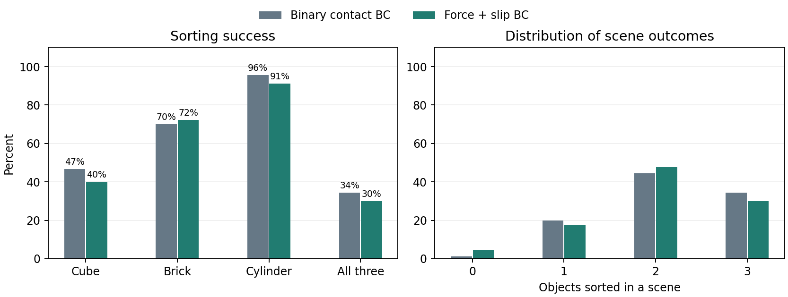

# 连续指尖接触力和滑移的分拣消融

## 试验设计

比较二值接触 BC 和增加连续力、滑移信息的 BC。两组都在已知物体和目标托盘的同一分拣任务中执行策略。每个 seed 使用与上一轮相同的三份三物体分拣示范和三份单物体示范，拥有相同的成功轨迹筛选、学习率、批次种子和优化次数。Seed 0、1、2 分别使用 1,300、700、250 次更新，沿用上一轮已独立选定的更新次数。二值组在本轮从相同的初始权重和同批数据重训，逐张量核对与归档模型完全相同。

连续信息通过重放原专家轨迹补录。真实分拣场景重放相同的专家轨迹，核对每步原始观测、动作、奖励、终止、动作阶段和逐件成功。单物体演示直接执行原始存档中的动作。增强数据保留原 52 维观测、5 维动作、回合边界、奖励和成功标签。新增训练场景为 0，重放只给原交互补录观测。

## 新增观测

| 特征 | 维数 | 含义 |
|---|---:|---|
| 左右指法向力 | 2 | 两侧 MuJoCo 指尖接触法向力，各自按 3 N 缩放，上限 6 N |
| 相对滑移速度 | 3 | 物体中心在手爪坐标系下，相邻控制步的相对位移除以时间 |
| 相对滑移位移 | 3 | 从这段连续接触起点累计的物体相对位移 |

滑移按手爪自身坐标系计算。至少一只指尖有接触时才记录，脱离后清空这一段的历史。它是仿真中的平移滑移代理，采样周期与控制一致。旧输入沿用同一个线性层，新增的 8 维输入通过零初始化的线性投影加入第一隐层。这样初始化时，两组动作逐元素相同。训练、部署和评估沿用相同的动作空间。

## 测试协议

两组分别使用三份权重在相同的 30 个新场景 1564000–1564029 上测试。物体、朝向、托盘位置和执行顺序逐场景配对。预先关注方块运输掉落，尤其是 seed 0，并同时比较合格抬升、单件成功和三件全对。方块条件掉落率以已经合格抬升的回合为分母。完整放置成功要求活体仿真中的夹持到达、释放、撤离、稳定 1 秒，以及整桌结束时物体仍在正确托盘。

[示范匹配和数据哈希](../results/place_sorting_contact/matched_demonstrations.csv) · [复现命令](../README.md)

## 成功率和掉落

| 指标 | 二值接触 BC | 连续力 + 滑移 BC |
|---|---:|---:|
| 方块合格抬升 | 80/90 | 85/90 |
| 方块运输掉落 | 27/90 | 29/90 |
| 每次合格抬升后的方块掉落 | 27/80（33.8%） | 29/85（34.1%） |
| 方块进红盘 | 42/90 | 36/90 |
| 长方块进蓝盘 | 63/90 | 65/90 |
| 圆柱进绿盘 | 86/90 | 82/90 |
| 单件分对 | 191/270（70.7%） | 183/270（67.8%） |
| 三件全对 | 31/90（34.4%） | 27/90（30.0%） |

| 训练 seed | 方块掉落变化 | 合格抬升变化 | 三件全对变化 |
|---|---:|---:|---:|
| 0 | 6 → 7 | 25 → 28 | 12 → 11 |
| 1 | 11 → 11 | 27 → 29 | 10 → 9 |
| 2 | 10 → 11 | 28 → 28 | 9 → 7 |

在 seed 0 的配对场景中，连续组避免了 2 次原方块掉落，同时新增 3 次。尽管合格抬升增加了 3 次，抬升后的掉落率仍由 24.0% 变为 25.0%。两组的方块抬升后掉落率总体接近。方块合格运抵目标由 53/90 增为 57/90，而运抵后最终未分对的情况由 11 次增至 21 次。整桌的同场景配对有 6 次从失败变为成功、10 次从成功变为失败，净少 4 次。

本轮从原始专家数据补录了 63,849 条转移，另重放 9,573 步相同的物理回程。新增的传感信号使模型接触到更丰富的状态，但动作标签仍来自原专家轨迹。实测结果表明，在这套信号编码、示范与直接 BC 的配置下，二值组的方块掉落和整桌成功指标更好。

[逐 seed 成功率](../results/place_sorting_contact/comparison.csv) · [按物体统计抬升与掉落](../results/place_sorting_contact/by_shape.csv) · [配对掉落与整桌得失](../results/place_sorting_contact/paired.csv) · [26 项测试](../results/place_sorting_contact/verification.txt)

## Seed 0 的配对回放

场景 1564026 的二值策略三件均通过。在连续力和滑移组中，方块先发生运输掉落，末态停在红盘，合格放置计时为 0 秒。长方块末态也在蓝盘，未达到合格抬升高度。圆柱通过完整放置判据。因此连续组计为一件成功。视频重放复核了逐件过程、最终颜色、稳定计时和整桌结果。

[二值接触回放](../results/place_sorting_contact/videos/binary_seed_0_scene_1564026_3of3.mp4) · [连续力和滑移回放](../results/place_sorting_contact/videos/continuous_seed_0_scene_1564026_1of3.mp4) · [视频判据](../results/place_sorting_contact/videos/criteria.json)
