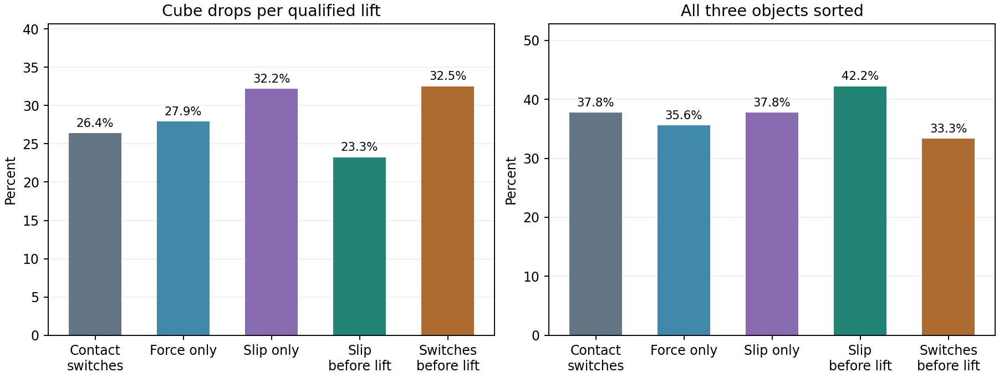

# 三阶段触觉与前一轮分拣失效诊断

## Seed 1 方块运输掉落

上一轮分阶段组使用运输期连续力、其余时段滑移。在共同的 30 个布局上，它的方块掉落比接触开关多 3 次，对应 6 次新增、3 次避免。6 次新增中，5 次在两组都合格抬升后发生，另 1 次在接触开关组没有合格抬升。

| 新增掉落 | 回放观测 |
|---|---|
| 1566002、1566011、1566012、1566014 | 方块进入 22 mm 目标半径时还在双指间，但高度分别为 46.8、42.3、33.8、42.9 mm，均没有达到合格运抵所需的 50 mm。之后方块脱手，最终掉落标记触发时距目标中心约 2–14 mm。 |
| 1566009、1566016 | 方块在进入目标半径前掉落，脱手前均接触到圆柱。后者是接触开关组未能抬升的布局。 |

在 6 个新增掉落场景中，近目标时临时增加运输高度，3 次避免掉落并合格运抵，其中 1 次完成整桌分拣。只在抬升前换成接触开关策略，3 次避免掉落并运抵，其中 1 次把方块放对。只在抬升前屏蔽滑移，1 次避免掉落并运抵，另 1 次因未抬升而无掉落。结果支持运输高度不足解释近目标的部分掉落，并显示抬升前动作也会改变之后的结果。

[配对事件及首次进入目标半径的高度](../results/place_sorting_contact_schedule/diagnosis/mechanisms.csv) · [抬升前干预](../results/place_sorting_contact_schedule/diagnosis/seed_1/events.csv) · [运输高度干预](../results/place_sorting_contact_schedule/diagnosis/seed_1/height_probe/events.csv)

## Seed 2 三件全对从 11 桌降到 6 桌

逐桌比较得到 6 桌丢失、1 桌救回。丢失的 6 桌均只失去一件物体。3 桌是方块运抵后的放置失败，2 桌是方块运输掉落，1 桌是长方块未抬到 5 cm。其中场景 1566010 的方块最终在红盘，但中途掉落且全过程稳定放置计时为 0 秒。

| 三个运抵后放置失败的方块 | 方块稳定分对 | 三件全对 |
|---|---:|---:|
| 原分阶段策略 | 0/3 | 0/3 |
| 仅在运抵后换用接触开关策略 | 0/3 | 0/3 |
| 仅在运抵后屏蔽滑移 | 0/3 | 0/3 |
| 仅在运输时换用接触开关策略，运抵后恢复原策略 | 2/3 | 1/3 |
| 在运抵前换用接触开关策略，运抵后恢复原策略 | 2/3 | 2/3 |

3 个原策略回合都在夹持触桌前出现脱手，均接触过托盘边缘。合格运抵只要求达到半径、携带高度和夹持标准。运输轨迹或抓取姿态带入的状态会影响接下来能否把物体稳定放下。运抵后改信号和动作均未救回这 3 个方块，提前改动作在部分场景有效。这些干预均只用于上一轮失败回放。

[放置阶段干预](../results/place_sorting_contact_schedule/diagnosis/seed_2/events.csv) · [运抵前干预](../results/place_sorting_contact_schedule/diagnosis/seed_2/arrival_probes/events.csv) · [接触开关成功回放](../results/place_sorting_contact_schedule/diagnosis/videos/binary_seed_2_scene_1566001_3of3.mp4) · [原分阶段组方块放置失败回放](../results/place_sorting_contact_schedule/diagnosis/videos/force_in_transport_seed_2_scene_1566001_2of3.mp4)

## 三阶段策略在新场景的表现

新组全程保留原 52 维观测，包括两指接触开关。抬升前屏蔽全部连续触觉。首次合格抬升到首次合格运抵之间加入左右指法向力，运抵后加入相对滑移。训练和推理使用同样的遮罩，单个 BC 网络输出末端移动、夹爪开合和腕部偏航动作。观测遮罩使用已有物理标记。滑移是仿真中按手爪坐标系计算的物体平移代理。

所有方法复用原专家示范、初始权重和采样顺序。三个 seed 使用此前已定的 1,300、700、250 次更新，同一 seed 内预算一致，学习率为 0.00025。三个新模型共复用 63,849 条原有转移。新增专家示范和在线训练交互均为 0。

五组共用此前未用于训练、验证或评估的 30 个布局（1567000–1567029），总计 450 桌、1,350 件物体尝试。运输掉落指合格抬升后、合格运抵前，方块完全脱离双指接触并受到桌面支撑，或完全脱手并降到静止位置以上 2.5 cm 以下。完整放置按夹持运抵、释放、撤离、稳定 1 秒和整桌结束仍留在正确托盘判定。测试过程使用策略原始动作。

| BC 输入 | 方块抬升 | 方块掉落 / 合格抬升 | 方块分对 | 三件全对 |
|---|---:|---:|---:|---:|
| 接触开关 | 87/90 | 23/87（26.4%） | 55/90 | 34/90（37.8%） |
| 全程加连续力 | 86/90 | 24/86（27.9%） | 53/90 | 32/90（35.6%） |
| 全程加滑移 | 87/90 | 28/87（32.2%） | 51/90 | 34/90（37.8%） |
| 原分阶段组 | 86/90 | **20/86（23.3%）** | **56/90** | **38/90（42.2%）** |
| 抬升前用开关、运输用力、放置用滑移 | 83/90 | 27/83（32.5%） | 49/90 | 30/90（33.3%） |

| Seed | 原分阶段组 掉落 / 合格抬升；全对 | 新组三阶段 掉落 / 合格抬升；全对 |
|---|---:|---:|
| 0 | 7/29；13/30 | 10/27；8/30 |
| 1 | 8/30；12/30 | 11/29；13/30 |
| 2 | 5/27；13/30 | 6/27；9/30 |

新组三个 seed 均比原分阶段组多掉方块，合计多掉 7 次，三件全对少 8 桌。Seed 0 合格抬升由 29 次降到 27 次，合格运抵由 21 次降到 17 次，三件全对净少 5 桌。Seed 1 整桌成功增加 1 次，但方块多掉 3 次。整桌表现和方块运输指标均以原分阶段组最佳。训练和测试的物理对象都位于同一类 MuJoCo 台面，以上量化结果覆盖本批布局和三个训练 seed。

[逐 seed 数据](../results/place_sorting_contact_schedule/by_seed.csv) · [逐场景配对得失](../results/place_sorting_contact_schedule/paired.csv) · [同预算核查](../results/place_sorting_contact_schedule/budget.csv) · [27 项测试](../results/place_sorting_contact_schedule/verification.txt) · [复现命令](../README.md#抬升前用接触开关运输用力放置用滑移)

[三阶段新场景成功回放](../results/place_sorting_contact_schedule/videos/binary_then_force_then_slip_seed_2_scene_1567024_3of3.mp4) · [三阶段新场景掉落回放](../results/place_sorting_contact_schedule/videos/binary_then_force_then_slip_seed_0_scene_1567001_2of3.mp4) · [逐件视频判据](../results/place_sorting_contact_schedule/videos/criteria.json)
