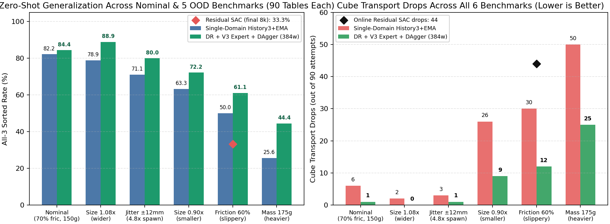

# 多物体分拣泛化攻坚：V3 专家、域随机化、单因素消融与在线残差 RL 对照

## 零样本 OOD 诊断与物理根因

对上一阶段单域策略 `history3_ema`（名义条件 **74/90 = 82.2%**）在 5 组分布外（OOD）条件下做零样本压力测试（冻结权重、零重训，每组 30 布局 × 3 seed = 90 桌，共 450 桌），并结合专家物理轨迹排查，定位到两个关键物理根因：

1. **圆柱 `back_left` 邻物干涉与落桌反弹**：原专家对圆柱固定使用 `tool_yaw = 0°` 抓取，双指张开时沿 X 轴宽约 110 mm，而 `back_left (0.459, -0.141)` 与 `back_right (0.541, -0.141)` 仅相距 82 mm，下降时易蹭碰邻物；同时较快下降（`limit = 0.70`）易导致圆柱触桌反弹骑上 8 mm 托盘墙。
2. **红方块低摩擦/加重/缩尺寸重力下溜**：70% 摩擦下 `cube` 指间法向力约 1.14 N，长程搬运时方块在指间持续下溜 15–25 mm。当摩擦降至 60%、质量增至 175 g 或 XY 缩小至 0.90× 时，单域策略方块掉落数从 6 次飙升至 26–50 次，而长方块（88–89/90）与圆柱（78–84/90）仍高度稳健。

## V3 专家与域随机化策略（`place_sorting_dr`）

- **V3 专家 (`RobustSortingTeacherV3`)**：① 圆柱自动将双指张开方向旋转至**垂直于最近在桌邻物连线**，并采用柔顺下降（`limit = 0.45`）；② 红方块下握加深至 `-6 mm`，抬升与运输阶段加入**有界下溜高度补偿**（上限 `+22 mm`，防止正反馈拉脱）。在 `1567000–1567029` 上，V3 专家名义成绩从 25/30 跃升至 **29/30（96.7%，`brick 30/30`、`cylinder 30/30`、`cube 29/30`）**；在全新 `1568000–1568029` 上为 **26/30（86.7%，`brick 30/30`、`cylinder 30/30`、`cube 26/30`，0 掉落）**。
- **域随机化策略 (`dr_history_dagger`)**：保持相同的 64 维观测接口与 `force_in_transport` 逐帧触觉门控，使用 384 宽残差三帧历史 EMA 网络，每 seed 采集 60 桌名义 + 60 桌 10 桶域随机化（覆盖 60%–70% 摩擦、150–175 g 质量、±12 mm 起点扰动、0.90×–1.08× 尺寸）带扰动示范，再追加 54 桌前缀接管 DAgger。注：Seed 1 的最终选中权重与 DAgger 前 R1 权重哈希一致，DAgger 增益存在 seed 差异，下文单因素消融专门拆清了这一影响。

## 配对压力测试（原 30 布局 `1567000–1567029` × 3 seed = 90 桌/组）

> 口径说明：下表 5 组单项压力条件对单域 `history3_ema` 属于未见 OOD；但对 `dr_history_dagger` 来说，其幅度已落在 10 桶域随机化训练范围内，因此这里衡量的是**训练覆盖扰动下的配对提升**。真正的未见布局与未见组合泛化见下一节。

| 测试条件 (`1567000–1567029`) | 单域 `history3_ema` 全对 (逐 seed) | `dr_history_dagger` 全对 (逐 seed) | 整桌净提升 | `dr` 单件分对 | `dr` 方块分对 / 掉落 (`hist` → `dr`) |
|---|---:|---:|---:|---:|---|
| **名义 `nominal`** (70% 摩擦, 150 g) | 74/90 (82.2%, 25/25/24) | **76/90 (84.4%, 27/25/24)** | **+2.2 pp** | **256/270 (94.8%)** | 分对 81→76；掉落 6/88→**1/87** |
| **尺寸放大 `size_108`** (1.08× XY) | 71/90 (78.9%, 24/24/23) | **80/90 (88.9%, 25/27/28)** | **+10.0 pp** | **260/270 (96.3%)** | 分对 82→83；掉落 2/85→**0/86** |
| **起点扩大 `jitter_12mm`** (±12 mm) | 64/90 (71.1%, 22/20/22) | **72/90 (80.0%, 25/23/24)** | **+8.9 pp** | **252/270 (93.3%)** | 分对 82→75；掉落 3/88→**1/90** |
| **尺寸缩小 `size_90`** (0.90× XY) | 57/90 (63.3%, 19/19/19) | **65/90 (72.2%, 20/24/21)** | **+8.9 pp** | **242/270 (89.6%)** | 分对 57→66；掉落 26/90→**9/90** |
| **摩擦再降 `friction_60`** (60% 摩擦) | 45/90 (50.0%, 16/14/15) | **55/90 (61.1%, 16/21/18)** | **+11.1 pp** | **234/270 (86.7%)** | 分对 49→55；掉落 30/88→**12/87** |
| **质量加重 `mass_175`** (175 g) | 23/90 (25.6%, 7/9/7) | **40/90 (44.4%, 14/13/13)** | **+18.8 pp** | **217/270 (80.4%)** | 分对 25→41；掉落 50/88→**25/87** |
| **全 6 组总计 (540 桌)** | **334/540 (61.9%)** | **388/540 (71.9%)** | **+54 桌 (+10.0 pp)** | **1461/1620 (90.2%)** | 总掉落 117 → **48 (-59%)** |

> 细节说明：名义条件下 `dr_history_dagger` 将方块运输掉落从 6 次降至 1 次，同时圆柱与长方块均达 90/90，但方块最终稳定分对从 81/90 略降至 76/90（多出部分非掉落放置失败），因此掉落率与最终稳定放置需分开追踪。

## 真正留出泛化复测：全新未见布局（`1568000–1568029`）与未见多轴组合

冻结已保存的 `history3_ema` 与 `dr_history_dagger` 三个 seed 权重（SHA-256 校验一致，零重训），在**此前从未用于任何训练、验证或调试的 30 个全新布局（`1568000–1568029`）**以及 **4 组从未出现在 `DR_BUCKETS` 中的多轴组合/外推参数**上独立复测：

| 全新布局条件 (`1568000–1568029`) | V3 专家 (30 桌) | 冻结 `history3_ema` (90 桌) | 冻结 `dr_history_dagger` (90 桌) | 整桌净差 | 方块分对 / 掉落 (`hist` → `dr`) |
|---|---:|---:|---:|---:|---|
| **`unseen_nominal`**（名义，新布局） | 26/30 (86.7%) | 58/90 (64.4%, 18/22/18) | **67/90 (74.4%, 21/24/22)** | **+10.0 pp** | 分对 72→68；掉落 12→**3** |
| **`unseen_feasible_combo`**（66% 摩擦 + 156 g + ±8 mm + 0.97×） | 24/30 (80.0%) | 39/90 (43.3%, 13/15/11) | **58/90 (64.4%, 18/21/19)** | **+21.1 pp** | 分对 45→**64**；掉落 39→**9** |
| **`unseen_extrap_fric57`**（57% 摩擦 + 155 g + ±7 mm，越界外推） | 4/30 (13.3%) | 16/90 (17.8%, 3/7/6) | **19/90 (21.1%, 6/6/7)** | **+3.3 pp** | 分对 22→**24**；掉落 63→**47** |
| **`unseen_combo_4way`**（62% 摩擦 + 162 g + ±9 mm + 0.95×，极限） | 3/30 (10.0%) | **11/90 (12.2%)** | 9/90 (10.0%，单件 **63.3%** vs 57.8%) | -2.2 pp | 分对 14→10；掉落 73→**64** |
| **`unseen_combo_heavy_small`**（66% 摩擦 + 168 g + ±11 mm + 0.92×，极限） | 4/30 (13.3%) | 2/90 (2.2%) | 2/90 (2.2%，单件 **58.5%** vs 55.6%) | 0.0 pp | 分对 5→2；掉落 80→**75** |

- 在**物理可行域内的全新布局与未见 4 轴组合**上，冻结 `dr_history_dagger` 优势非常明确：全新名义布局 **+10.0 pp（64.4% → 74.4%）**，未见可行 4 轴组合 **+21.1 pp（43.3% → 64.4%，方块掉落从 39 次骤降至 9 次）**。
- 当三至四个不利轴同时推过 1.14 N 夹爪静摩擦极限时（如 57% 摩擦或 62% 摩擦+162 g+0.95×），连 V3 专家自身也跌至 10%–13.3%，此时两种策略的整桌成绩均受物理边界限制，但 `dr_history_dagger` 在全部 3 组极限条件上仍保持更低方块掉落与更高单件分对率。

## 同专家、同预算、同架构的单因素消融：拆清 DR 与保真 DAgger 的各自贡献

固定 **同一套 V3 专家、同一套 384w 残差三帧历史 EMA 架构、相同总示范预算（每 seed 恰好 120 桌）和相同总梯度步数（8,000 步、批大小 384）**，在全新未见布局 `1568000–1568029` 上做严格三臂消融。其中 `dr_plus_dagger` 修正了前序物体重放逻辑——**所有前序非目标物体均由原策略严格重放，并逐桌断言接管入口 `cube_xyz` 误差 `< 1e-5`（77/77 次入口状态零偏差校验通过）**：

| 消融臂（同 V3 专家 / 120 桌 / 8,000 步 / 384w） | `unseen_nominal` (90 桌) | `unseen_feasible_combo` (90 桌) | `unseen_extrap_fric57` (90 桌) | 三组总计 (270 桌) |
|---|---:|---:|---:|---:|
| **`nominal_only`**（120 名义） | 60/90 (66.7%, 17/22/21, 0 掉) | 52/90 (57.8%, 13/18/21, 12 掉) | **23/90 (25.6%, 48 掉)** | 135/270 (50.0%) |
| **`dr_only`**（60 名义 + 60 DR） | **65/90 (72.2%, 20/25/20, 0 掉)** | **59/90 (65.6%, 19/21/19, 9 掉)** | 22/90 (24.4%, 48 掉) | **146/270 (54.1%)** |
| **`dr_plus_dagger`**（45 名义 + 45 DR + 30 保真 DAgger） | 61/90 (67.8%, 20/22/19, 0 掉) | 48/90 (53.3%, 17/15/16, 14 掉) | 21/90 (23.3%, 47 掉) | 130/270 (48.1%) |

**单因素归因结论**：
1. **域随机化（`dr_only` vs `nominal_only`）是明确、稳定的单因素净增益**：在完全相同的 120 桌预算下，用 60 桌 DR 替换 60 桌名义示范，在全新名义布局上净增 **+5.5 pp（66.7% → 72.2%）**，在未见 4 轴组合上净增 **+7.8 pp（57.8% → 65.6%）**，三组总计净增 **+11 桌**。
2. **固定 120 桌预算内，牺牲初始全轨迹覆盖换取 30 桌前缀 DAgger 反而亏损（146 → 130 桌）**：30 桌 DAgger 每 seed 仅产出 15–19 条短纠偏后缀（约 1,100 步），且仅 Seed 0 在验证集超过 R1；而完整 120 桌全轨迹（`dr_only`）覆盖更充分。只有当 DAgger 作为 120 桌之上的**额外增量**时（如冻结的 `dr_history_dagger` 120+54 桌在 `unseen_nominal` 达 67/90），才略优于 120 桌 `dr_only`（65/90）。

## 零新示范在线残差 SAC 适应对照（`friction_60`）

为验证在 60% 摩擦条件下不提供任何新专家示范、纯靠在线物理交互能否提升冻结 `history3_ema` 基线，在相同 3 seed 上严格分列**验证选模权重（`test_selected`）**与**训练末步权重（`test_final`）**：

| `friction_60` 适应方法与评估权重 | 新增示范 | 在线步数 / seed | 验证集 (36 桌) | 独立测试全对 (90 桌) | 测试单件分对 | 方块掉落 / 抬升 |
|---|---:|---:|---:|---:|---:|---:|
| 冻结 `history3_ema` 基线 | 0 | 0 | 11/36 | 45/90 (50.0%, 16/14/15) | 217/270 (80.4%) | 30/88 (34.1%) |
| 全阶段残差 SAC（无预热 + 悬停奖励） | 0 | 10,000 | 1/36（悬停刷分退化） | — | — | — |
| 运输期门控残差 SAC — **验证选模 (`test_selected`)** | 0 | 8,000 | 3 seed 均选中 `step=0` | 45/90 (50.0%, 16/14/15) | 217/270 (80.4%) | 30/88 (34.1%) |
| 运输期门控残差 SAC — **末步权重 (`test_final`, step 8000)** | 0 | 8,000 | 9/36（未崩但弱于 step 0） | 30/90 (33.3%, 9/13/8) | 200/270 (74.1%) | 44/88 (50.0%) |
| **`dr_history_dagger`**（参考：DR 监督） | 60 DR + 54 DAgger | 0 | — | **55/90 (61.1%, 16/21/18)** | **234/270 (86.7%)** | **12/87 (13.8%)** |

现有证据说明：运输期门控 + 1,500 步 Critic 预热 + 纯任务回报成功阻止了全阶段残差 SAC 的策略崩溃，但在 8,000 在线步预算下，三个 seed 验证集均退回 `step=0` 冻结基线，且末步权重（30/90）仍弱于冻结基线（45/90）。

## 存档与回放

[1567xxx 配对扰动 CSV](../results/place_sorting_dr/ood_comparison.csv) · [全新 1568xxx 冻结泛化数据](../results/place_sorting_unseen) · [120 桌三臂单因素消融数据](../results/place_sorting_ablation_dr_dagger) · [残差 SAC 选模/末步分离数据](../results/place_sorting_residual_sac_gated/friction_60) · [33 项单元测试日志](../results/place_sorting_dr/verification.txt)

[DR 名义 3/3 成功回放](../results/place_sorting_dr/videos/dr_nominal_seed_0_scene_1567002_3of3.mp4) · [DR 60% 摩擦救回 3/3 回放](../results/place_sorting_dr/videos/dr_friction_60_seed_1_scene_1567000_3of3.mp4) · [视频核验判据](../results/place_sorting_dr/videos/criteria.json)
