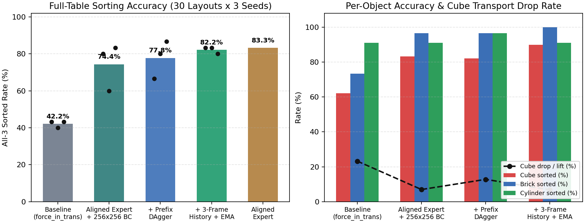

# 三物体分拣准确率提升：对齐专家、前缀 DAgger 与三帧历史策略

## 42.2% 基线的失败根因拆解

对上一轮最佳组 `force_in_transport`（[place_sorting_contact_schedule_report.md](place_sorting_contact_schedule_report.md)，38/90 全对、204/270 单件）在 30 个新布局（`1567000–1567029`）× 3 seed 的逐件记录与训练示范联合排查，定位到三个核心瓶颈：

1. **原同桌专家自身在红方块上仅 63.9%（46/72）**：70% 摩擦、150 g 条件下长程搬运时方块在指间重力下溜，且原专家进盘前不将方块偏航转正对齐托盘墙，导致 23/26 次专家方块失败落在距中心 13–25 mm 处碰 8 mm 托盘墙出界。由于 BC 只保留成功示范，每 seed 同桌有效方块轨迹仅约 15 条，长程后中槽 `slot 2` 成功率仅 33.3%（6/18）。
2. **蓝长方块 `|yaw| ≥ 60°` 的 ±π 动作割线**：52 维观测对长方块使用 `2 * object_yaw` 的 `(cos, sin)`，在 `±90°` 处连续重合，而专家目标偏航在 `±90°` 处从 `+90°` 跳变到 `-90°`。单峰 MSE 网络把正负监督平均，导致跨三批独立测试集（270 件）长方块在 `|yaw| < 60°` 为 83.3%，`|yaw| ≥ 60°` 骤降至 44.0%。
3. **无托盘老数据稀释与单帧观测盲区**：原有训练将无托盘单物体历史示范与同桌示范 1:1 混采，稀释了高飞入盘习惯；且策略看不见桌上其余两件物体位置，也没有短历史时序信息抑制搬运/释放阶段抖动。

## 改进方案

所有新实验保持原有归档代码与权重不变，使用相同的 30 个独立测试布局（`1567000–1567029`）与 3 个训练 seed：

- **阶段 1（`aligned_r1`）**：升级同桌专家（下握深 3 mm、温和抬升、满速搬运减少下溜时间、入盘偏航转正对齐托盘、放宽 `DESCEND` 阈值防卡死），专家在 30 个测试布局上达到 **25/30（83.3%）**；在 60 维分阶段触觉观测后追加 4 维上下文——未折叠 `(cos(object_yaw), sin(object_yaw))`（消除长方块 ±90° 割线）与最近其余物体相对 TCP 的 XY 坐标（共 64 维）；每 seed 采集 60 桌带执行扰动的同桌示范，从头训练 256×256 LayerNorm+SiLU 策略。
- **阶段 2（`dagger`）**：在 60 桌新训练场景上运行阶段 1 策略，定位失败物体并重放至失败前前缀，由完全一致的 `AlignedSortingTeacher` 接管完成放置，仅保留物理验证成功的纠偏后缀，按 75%/25% 混合微调。
- **阶段 3（`history3_ema`）**：零新增示范，完全复用阶段 1 与 DAgger 数据集，将最近 **3 帧（150 ms）** 观测堆叠为 192 维输入（逐帧保留 `force_in_transport` 触觉门控），按 85%/15% 配比训练并采用 `EMA (decay=0.995)` 权重平滑。

## 独立测试对照（30 新布局 × 3 seed = 90 桌 / 270 件）

| 方法 | 三件全对 (90 桌) | 逐 seed 全对 (0 / 1 / 2) | 单件分对 (270 件) | 红方块 `cube` | 蓝长方块 `brick` | 绿圆柱 `cylinder` | 方块掉落 / 抬升 |
|---|---:|---|---:|---:|---:|---:|---:|
| 原最佳基线 (`force_in_transport`) | 38/90 (42.2%) | 13 / 12 / 13 | 204/270 (75.6%) | 56/90 (62.2%) | 66/90 (73.3%) | 82/90 (91.1%) | 20/86 (23.3%) |
| 对齐专家 + 256×256 BC (`aligned_r1`) | 67/90 (74.4%) | 24 / 18 / 25 | 244/270 (90.4%) | 75/90 (83.3%) | 87/90 (96.7%) | 82/90 (91.1%) | 6/86 (7.0%) |
| + 前缀接管 DAgger (`dagger`) | 70/90 (77.8%) | 20 / 24 / 26 | 248/270 (91.9%) | 74/90 (82.2%) | 87/90 (96.7%) | 87/90 (96.7%) | 11/86 (12.8%) |
| + 3 帧短历史 + EMA (`history3_ema`) | **74/90 (82.2%)** | **25 / 25 / 24** | **253/270 (93.7%)** | **81/90 (90.0%)** | **90/90 (100.0%)** | 82/90 (91.1%) | **6/88 (6.8%)** |
| *参考：新版专家 (`aligned_expert`)* | *25/30 (83.3%)* | *—* | *83/90 (92.2%)* | *28/30 (93.3%)* | *30/30 (100.0%)* | *25/30 (83.3%)* | *1/30 (3.3%)* |

- **整桌准确率翻倍**：三件全对从 **42.2% 提升至 82.2%（+40.0 pp）**，基本追平新版专家（83.3%）；单件分对率达 **93.7%（253/270）**，超过新版专家的 92.2%。
- **跨 seed 高度稳定**：`history3_ema` 三个 seed 全对分别为 **25 / 25 / 24**，红方块均为 **27/30（90.0%）**，蓝长方块三个 seed 均达 **30/30（90/90 = 100.0%）**，全程 `wrong_color_items = 0`、`homing_failures = 0`。

## 附加对照：外层允许单件 1 次失败重抓（系统级）

在不重新训练 `history3_ema` 权重的前提下，若外层任务状态机在单件失败且物体仍在桌上时自动归位并允许重试 1 次，90 桌共触发 22 次重试，三件全对进一步升至 **77/90（85.6%，逐 seed 25 / 26 / 26）**，单件分对保持 **253/270（93.7%）**。其中绿圆柱抓取失败救回明显（82 → 85/90），但对掉在托盘边缘的物体直接重抓因超出训练取物区分布，偶尔会碰动相邻已放好物体。该指标与单次策略表现分开统计。

## 存档与回放

[总汇总](../results/place_sorting_history/overall.csv) · [逐 seed 数据](../results/place_sorting_history/by_seed.csv) · [逐物体统计](../results/place_sorting_history/by_shape.csv) · [失败阶段分布](../results/place_sorting_history/failure_stages.csv) · [1 次重试汇总](../results/place_sorting_history/retry_summary.csv) · [29 项单元测试日志](../results/place_sorting_history/verification.txt)

[基线失败→新策略 3/3 成功回放](../results/place_sorting_history/videos/history3_ema_seed_0_scene_1567002_3of3.mp4) · [剩余失败回放](../results/place_sorting_history/videos/history3_ema_seed_0_scene_1567004_1of3.mp4) · [视频核验判据](../results/place_sorting_history/videos/criteria.json)
