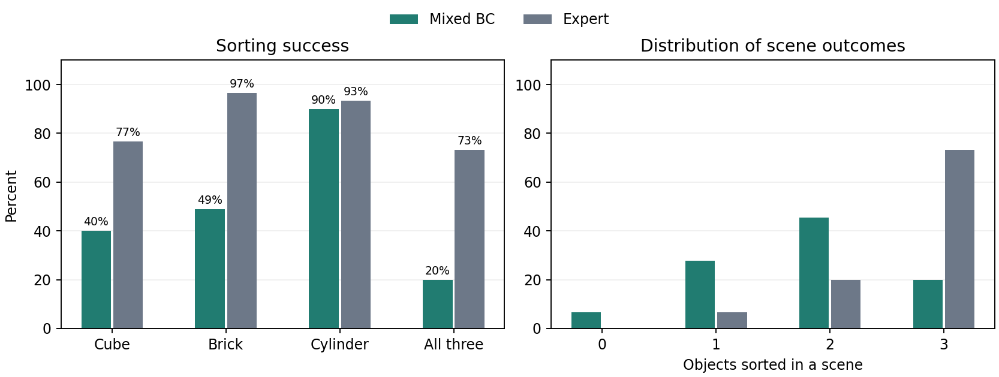

# 三物体彩色托盘分拣试验

## 场景与成功判据

方块、长方块和圆柱同时放在桌上，由 Panda 的单夹爪逐件抓取。红色方块进红盘、蓝色长方块进蓝盘、绿色圆柱进绿盘。物体使用更亮的同色系，便于从托盘中辨认。每个场景打乱物体起始位置、初始偏航、抓取顺序和托盘颜色所在的位置。三个托盘使用同一桌面承重，带有可发生碰撞的 8 mm 高围边，内部为 86 × 84 mm。质量均为 150 g。四个开发场景与最后 30 个场景互斥。

场景程序提供待抓物体和对应托盘坐标。混合 BC 直接输出平移、夹爪和腕部偏航动作，专家沿用上一阶段的对准和触桌控制。两种方法都在每次尝试后用同一个位置伺服程序开爪、抬起并返回起始区。整个场景只重置一次，三件物体和托盘碰撞一直留在同一份 MuJoCo 状态中。回程和选择下一个目标时，已经放置的物体继续受物理作用。使用上一阶段的三个独立混合 BC 检查点，本轮新增训练为 0 步。

单件记为成功时，机器人需把物体合格抬升 5 cm 后夹持搬进指定托盘的目标区，释放并撤离。物体完整投影须在托盘围边内，由桌面承重并连续稳定至少 1 秒。最后再检查它仍在正确颜色的托盘内。整桌成功要求三件全部通过。

## 独立场景实测

| 策略 | 方块进红盘 | 长方块进蓝盘 | 圆柱进绿盘 | 单件分拣成功 | 三件全对 |
|---|---:|---:|---:|---:|---:|
| 混合 BC，seed 0 | 17/30 | 6/30 | 24/30 | 47/90（52.2%） | 5/30（16.7%） |
| 混合 BC，seed 1 | 7/30 | 18/30 | 28/30 | 53/90（58.9%） | 4/30（13.3%） |
| 混合 BC，seed 2 | 12/30 | 20/30 | 29/30 | 61/90（67.8%） | 9/30（30.0%） |
| 混合 BC，三组汇总 | 36/90（40.0%） | 44/90（48.9%） | 81/90（90.0%） | **161/270（59.6%）** | **18/90（20.0%）** |
| 对准专家 | 23/30 | 29/30 | 28/30 | **80/90（88.9%）** | **22/30（73.3%）** |

三个训练 seed 与专家使用同一批 30 个场景。BC 三组的 90 次整桌执行中，三件全对 18 次、分对两件 41 次、分对一件 25 次、零件分对 6 次。统计分母包含所有尝试，包括之前的物体已经失败的场景。三组 BC 和专家的回程均到达预定起始区。

109 次 BC 单件失败主要出现在 **运输阶段 46 次、抬升阶段 40 次**。方块的 54 次失败中有 36 次未完成合格运输。长方块的 46 次失败中有 26 次已夹持但未达到合格抬升。另有 3 件在阶段结束时通过稳定判定，随后在整桌结束时已离开正确托盘或不再满足末态检查。只有 1 件停在错误颜色的托盘内。那一回合的方块原指向红盘，运输过程中掉落到蓝盘。结果衡量的是给定目标后的抓放和多件任务完成能力，颜色对应关系由任务程序提供。

[逐 seed 场景汇总](../results/place_sorting/comparison.csv) · [逐形状结果](../results/place_sorting/by_shape.csv) · [失败阶段](../results/place_sorting/failure_stages.csv) · [23 项测试记录](../results/place_sorting/verification.txt)

## 分拣回放

场景 1561011 的抓取顺序为长方块、方块、圆柱。蓝盘、红盘、绿盘各有一件对应物体，三件在整桌结束时均通过检查。场景 1561000 使用同一训练权重。方块和圆柱正确入盘，长方块形成接触后未达到合格抬升，整桌记为分对两件。视频已对照逐件判据、终止状态和帧数重新验证。

[三件全部分对](../results/place_sorting/videos/mixed_seed_0_scene_1561011_3of3.mp4) · [只有两件分对](../results/place_sorting/videos/mixed_seed_0_scene_1561000_2of3.mp4) · [视频判据记录](../results/place_sorting/videos/criteria.json)
