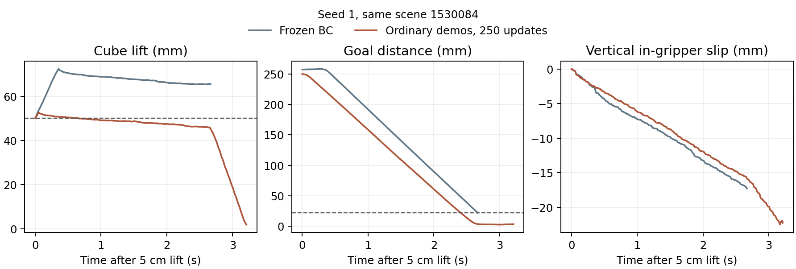
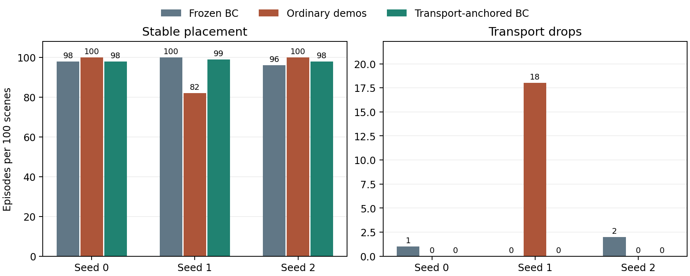

# 运输动作约束与普通专家补示范

## 固定更新 250 次后的 seed 1 掉落

在上一轮独立测试中，seed 1 的普通专家补示范出现 10 次新增运输掉落，边缘补示范出现 6 次，两组有 5 个掉落场景重合。选取普通补示范的全部 10 次掉落、边缘组特有的一次掉落，以及普通补示范与冻结策略都稳定放置的前 10 个对照场景。用原动作路径重放，逐回合核验判据和终止步数，并记录 2 ms 物理采样和每个控制步的两组策略动作。冻结策略对 10 个普通补示范掉落场景全部完成合格运输，9 次稳定放置。

在这 10 个场景中，普通补示范策略仍全部达到过 5 cm，但方块峰值高度的中位数由冻结策略的 **71.7 mm** 降至 **53.4 mm**。失去合格搬运高度前，距离目标最近仍有 **35.9–192.2 mm**。最终方块滑到距目标中心约 3–7 mm 处，却始终没有在双指夹持、高度至少 50 mm 的条件下进入 22 mm 目标圈，因此按运输掉落统计。10 次中只有 4 次在运输阶段出现明显松爪指令，即归一化夹爪动作大于 −0.5。这些结果把退化定位在到达之前的动作和物体轨迹。

| 在普通补示范策略上的诊断替换 | 10 次原掉落中的剩余掉落 | 恢复稳定放置 | 10 个对照仍稳定 |
|---|---:|---:|---:|
| 沿用全部已更新动作 | 10 | 0 | 10 |
| 仅换回合格抬升后的夹爪动作 | 9 | 1 | 9 |
| 仅换回合格抬升后的 Z 动作 | 8 | 2 | 8 |
| 换回合格抬升后的 XYZ 动作 | 3 | 7 | 7 |
| 换回合格抬升后的四维动作 | 2 | 8 | 9 |
| 从接近到合格到达全部用冻结策略动作 | 0 | 10 | 10 |

替换后的观察仍来自真实物理轨迹。各组件替换会改变后续状态，表中的恢复数用于定位可干预阶段。运输阶段的平移和高度余量是主要可干预因素，合格抬升之前的动作也影响恢复。单独覆盖 Z 或夹爪不足以解释全部掉落。

[阶段替换结果](../results/place_transport_anchor/diagnosis/summary.csv) · [高度与距离统计](../results/place_transport_anchor/diagnosis/clearance.csv) · [逐步动作](../results/place_transport_anchor/diagnosis/policy_trace.csv) · [物理轨迹](../results/place_transport_anchor/diagnosis/physics_trace.csv)

## 匹配预算与约束方法

两组都从相同的冻结 BC 权重出发，每 seed 使用上一轮同一批 **6,000 步普通专家补示范**、相同的历史低摩擦示范、同一 PyTorch BC 架构、同一学习率和批次种子，固定执行 **250 次**优化更新。普通补示范对照直接使用上一轮固定更新检查点并核对哈希。本轮复用采集记录，新增的采集步数和在线 RL 步数均为 0。冻结策略作为零补示范的参考。

约束组在原 BC 损失上加一项动作保持损失。用三份相同训练数据的成功回合，提取接近闭爪及初始抬升、远离目标的运输、靠近目标的运输三类观测。每组每次抽取 48 条，在相同观测上最小化新策略与冻结策略的动作平方差，损失倍率为 20，X、Y、Z、夹爪动作权重分别为 1、1、3、2。抓取邻域为末端到方块中心距离不超过 5 cm，近目标运输为离目标不超过 8.5 cm。达到目标后的示范仍按原 BC 损失学习。约束只用于训练，测试和视频直接执行各自网络输出。

新测试场景为 1540000–1540099，三个 seed 共享其起点和目标。固定使用最终 250 次更新权重，与诊断回放场景分开。主指标为稳定放置和运输掉落，同时记录严格夹持触桌及合格抬升。Seed 1 在训练样本池的远端运输状态中，Z 动作相对冻结策略的平均绝对偏差由普通补示范的 0.0108 降至 0.0010。该统计衡量动作约束效果，独立场景用于检验任务表现。

[训练配置](../results/place_transport_anchor/seed_1/config.json) · [动作偏差](../results/place_transport_anchor/seed_1/transport_action_drift.csv)

## 独立场景结果

| 方法 | 稳定放置（seed 0／1／2） | 运输掉落（seed 0／1／2） | 合格抬升 | 严格触桌并放置 |
|---|---:|---:|---:|---:|
| 冻结 BC | 294/300（98／100／96） | 3/300（1／0／2） | 300/300 | 174/300 |
| 普通补示范，固定 250 次更新 | 282/300（100／82／100） | 18/300（0／18／0） | 300/300 | 246/300 |
| 普通补示范加运输动作约束，固定 250 次更新 | 295/300（98／99／98） | 0/300（0／0／0） | 300/300 | 215/300 |

相对普通补示范，加约束的策略在同场景挽回全部 18 次运输掉落和稳定放置，同时有 5 个原稳定回合变为失败，净增 13 次。5 次失败均已合格搬运到目标，剩余问题出现在放置阶段。相对冻结 BC，运输掉落由 3 次降为 0 次，稳定放置有 6 次恢复、5 次回退，净增 1 次。Seed 1 的普通补示范掉落从 18 次降为 0 次，稳定放置从 82 次升至 99 次，同场景冻结 BC 为 100 次。

约束组的严格夹持触桌成功数高于冻结 BC，低于普通补示范。普通组的 18 次运输掉落均停在目标圈内，却没有以合格的夹持和高度搬运进入目标区。因此最终 XY 误差、运输结果和稳定放置需共同读。结论覆盖本次 70% 摩擦、150 g 固定朝向方块和三个检查点。相对无约束更新，运输保持的收益明显。相对冻结策略，稳定放置的净变化只有一次。

[逐 seed 汇总](../results/place_transport_anchor/comparison.csv) · [同场景得失](../results/place_transport_anchor/paired.csv) · [普通 BC 离线权重重建核对](../results/place_transport_anchor/ordinary_checkpoint_rebuild.json) · [20 项测试日志](../results/place_transport_anchor/verification.txt)

## 同场景视频

在场景 1540047，普通补示范的方块最后离目标中心 11.6 mm，肉眼可见方块落在目标圈内。它在运输过程中先低于抬升阈值，随后未在合格高度下夹持进入目标圈，回放记为运输掉落。加约束后完成合格搬运、夹持触桌和连续 1 秒的稳定放置，最终误差为 6.2 mm。两条视频均复核了真实动作回放、运输状态、两种放置判据、终止步数和帧数。

[普通补示范回放](../results/place_transport_anchor/videos/ordinary_seed_1_1540047.mp4) · [加约束后的稳定放置](../results/place_transport_anchor/videos/transport_anchored_seed_1_1540047.mp4) · [判据核验](../results/place_transport_anchor/videos/criteria.json)
